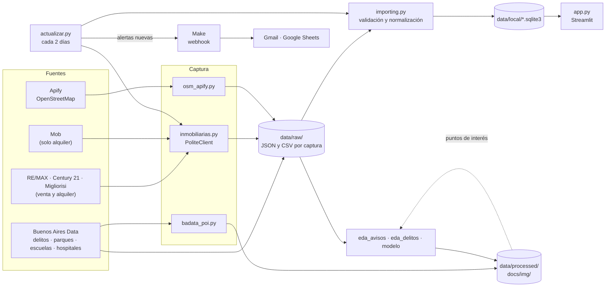
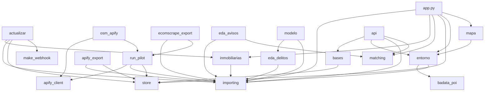
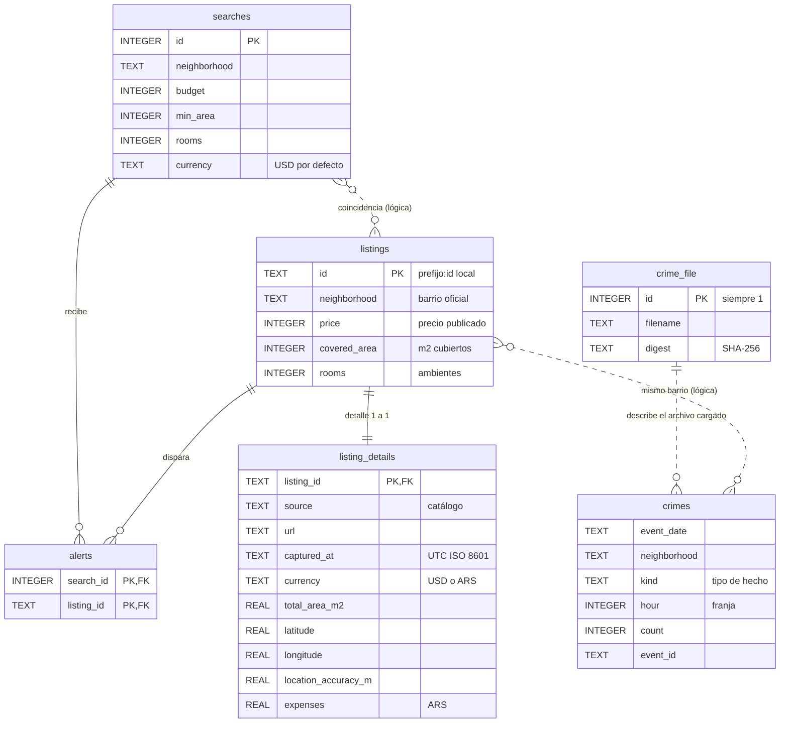
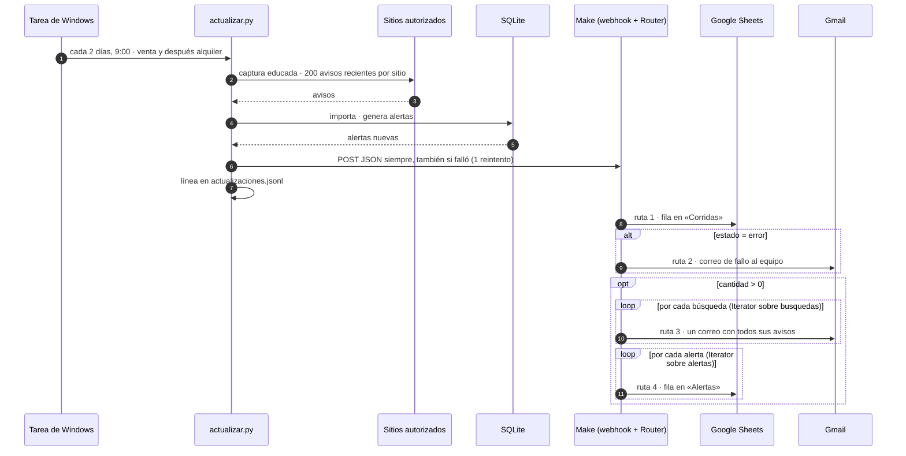
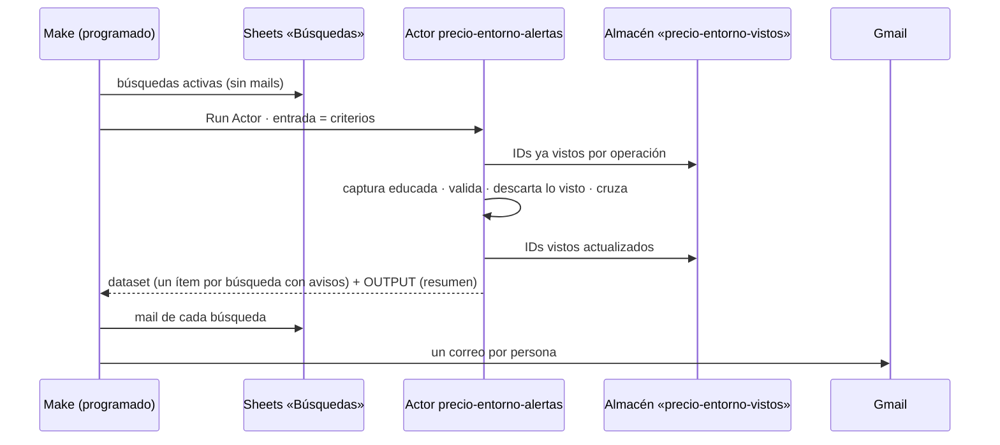

# Arquitectura técnica

Estado al 8 de noviembre de 2026. Describe cómo está construido el proyecto, cómo entran los datos, dónde se guardan, cómo se conectan los módulos y qué servicios externos participan. Todo corre en una sola computadora con Windows, sin servidor propio.

| Indicador | Valor |
| --- | --- |
| Código | 16 archivos en `precio_entorno/` más `app.py`, 2.952 líneas |
| Pruebas | 57, todas pasan |
| Avisos de venta en SQLite | 3.807 |
| Avisos de alquiler en SQLite | 3.271 |
| Registros de delitos 2025 por base | 130.418 |
| Gasto en Apify | USD 9,09 de USD 25 |

## 1. Stack

| Capa | Tecnología | Para qué se usa |
| --- | --- | --- |
| Lenguaje | Python 3.13 (Microsoft Store, Windows 10) | Todo el código: captura, validación, base, análisis y app |
| Interfaz | Streamlit 1.x | App web local (`app.py`, puerto 8501): preferencias, comparación de barrios, búsquedas y alertas |
| Base de datos | SQLite (`sqlite3` de la biblioteca estándar) | Un archivo por operación y modo: avisos, delitos, búsquedas y alertas |
| Captura web | Scrapling 0.5 (`Fetcher`), `urllib.robotparser` | Lectura educada de RE/MAX, Century 21, Migliorisi y Mob |
| Análisis | pandas 2, NumPy, matplotlib | Informes exploratorios de avisos y delitos, y sus figuras |
| Modelo | scikit-learn (`HistGradientBoostingRegressor`, `GroupKFold`) | ¿Los delitos mejoran la predicción del precio publicado por m²? |
| Geografía | pyproj | Conversión de los datasets de BA Data de EPSG:9498 a latitud y longitud |
| Servicios HTTP | `urllib.request`, sin dependencias | Clientes propios de la API de Apify y del webhook de Make |
| Extracción paga | Apify (4 cuentas, tope de USD 5 cada una) | Puntos de interés de OpenStreetMap y pilotos de Zonaprop |
| Automatización | Programador de tareas de Windows y `scripts/actualizar.cmd` | Captura e importación cada 2 días |
| Notificación | Make (región us2), Gmail y Google Sheets | Un correo y una fila de planilla por cada alerta nueva |
| Pruebas | `unittest` | 57 pruebas con datos sintéticos y ficticios, sin red |

## 2. Arquitectura

El sistema tiene dos circuitos que comparten la misma validación:
- **Producto:** captura avisos, los guarda y genera alertas.
- **Análisis:** lee las capturas crudas y produce los informes y el modelo del capstone.



Las flechas indican el sentido de los datos. La app y la actualización automática leen y escriben la misma base SQLite.

## 3. Carpetas

```text
precio-entorno-caba/
├── app.py                      # App Streamlit
├── AGENTS.md                   # Reglas del proyecto (fuentes, topes, secretos)
├── README.md                   # Guía de uso
├── requirements.txt            # streamlit, pandas, matplotlib, scikit-learn, scrapling, pyproj
├── .env                        # Secretos locales · fuera de Git
├── .env.example                # Plantilla sin valores
├── .gitignore
├── .claude/launch.json         # Arranque de Streamlit para la vista previa
├── precio_entorno/             # Paquete Python: 16 archivos
├── tests/                      # 15 archivos, 57 pruebas
├── scripts/actualizar.cmd      # Lo ejecuta la tarea de Windows
├── docs/
│   ├── alcance.md · arquitectura.md · datos.md · modelo.md
│   ├── eda-avisos.md · eda-delitos.md
│   ├── pedidos-de-acceso.md · validacion-inmobiliaria.md
│   ├── plantillas/registro-validacion.csv
│   ├── apify-piloto-input.json · apify-ecomscrape-input.json
│   └── img/eda-avisos/ · img/eda-delitos/   # 6 figuras
└── data/                       # Todo fuera de Git salvo fixtures y los README
    ├── fixtures/        7 KB   # Datos ficticios: demo.json, avisos y delitos de prueba
    ├── raw/            59 MB   # Capturas crudas, una carpeta por corrida
    │   ├── inmobiliarias-20261107/            # Venta: avisos.json + registro.json
    │   ├── inmobiliarias-alquiler-20261107/   # Alquiler de inmobiliarias
    │   ├── mob-alquiler-20261108/             # Alquiler de Mob
    │   ├── osm-20261107/                      # 9 categorías de OpenStreetMap
    │   ├── badata-poi/                        # GeoJSON oficiales
    │   ├── delitos_2024.csv · delitos_2025.csv
    │   └── piloto-* · inmobiliarias-piloto-*  # Pilotos y corridas de prueba
    ├── processed/      23 MB   # Tablas de los informes, datasets y resultados del modelo
    └── local/          13 MB   # Bases SQLite, historial y log de actualizaciones
```

## 4. Módulos

Cada módulo se puede correr solo con `python -m precio_entorno.<módulo>`. `importing.py` es el centro: define los barrios oficiales, el contrato de datos y los rangos válidos, y casi todos los demás lo usan.



Una flecha de A a B significa que A importa B. `badata_poi`, `store`, `matching`, `make_webhook` y `apify_client` no dependen de otros módulos del proyecto.

| Módulo | Líneas | Qué hace | Lee | Escribe |
| --- | ---: | --- | --- | --- |
| `importing` | 270 | Contrato de datos: barrios oficiales y alias, monedas, rangos de precio y de m² por operación, expensas y validación de pines. Lee CSV y JSON de avisos y el CSV de delitos. | Archivos de avisos y delitos | Avisos validados → `store` |
| `store` | 138 | Esquema SQLite, migraciones, ingesta con alertas, búsquedas y resumen de delitos | `data/local/*.sqlite3` | `data/local/*.sqlite3` |
| `matching` | 22 | Compara barrios: cuántos avisos cumplen presupuesto, superficie, ambientes y moneda, y su precio mediano | Avisos | Tabla para la app |
| `inmobiliarias` | 512 | Cliente educado y adaptadores de RE/MAX (API JSON), Century 21 (payload RSC), Migliorisi (HTML) y Mob (payload RSC y sitemap) | Sitios autorizados | `data/raw/<captura>/avisos.json` y `registro.json` |
| `actualizar` | 98 | Captura los avisos recientes, los importa, registra el historial y envía las alertas nuevas a Make | Sitios y base | Base, `actualizaciones.jsonl` y webhook |
| `make_webhook` | 66 | Valida la URL del webhook (https en `*.make.com`), arma el JSON y lo envía con un reintento | `MAKE_WEBHOOK_URL` | POST a Make |
| `apify_client` | 40 | Cliente mínimo de la API de Apify: pedidos y espera de corridas | Token | — |
| `run_pilot` | 274 | Piloto de Zonaprop con un actor de Apify. Valida el esquema y la tarifa del actor, y lee los tokens del `.env`. | Apify | `data/raw/piloto-zonaprop/` |
| `osm_apify` | 159 | Plan y corridas del extractor de OpenStreetMap, con tope de gasto por cuenta y control de tarifa | Apify | `data/raw/osm-20261107/` |
| `apify_export` | 80 | Convierte una exportación de dataset de Apify al contrato de datos | JSON de Apify | Base |
| `ecomscrape_export` | 82 | Adaptador del actor de EcomScrape para Zonaprop (su corrida fue rechazada) | JSON de Apify | Archivo de avisos |
| `api` | 250 | API FastAPI de la interfaz web: barrios con avisos que encajan, avisos por barrio, capas recortadas al barrio, delitos por celda, fuentes y alertas. Sirve la página de `web/`. | Bases SQLite, `data/processed/entorno/` y el CSV de delitos de `data/raw/` | Búsquedas en las bases |
| `bases` | 46 | Rutas de las bases de la demo y reales por operación, y carga del lote ficticio de la demo | `data/fixtures/demo.json` | Base de la demo |
| `entorno` | 550 | Prepara las capas del mapa y el resumen por barrio oficial: subte, CeSAC, hospitales, escuelas, espacios verdes, grilla de ruido y riesgo hídrico. Arma las columnas de la comparación y suma los delitos por celda. | `data/raw/badata-entorno/` y `data/raw/badata-poi/` | `data/processed/entorno/` |
| `mapa` | 166 | Mapa pydeck del barrio con capas activables, leyenda y advertencias | Capas de `entorno` | Mapa de la app |
| `badata_poi` | 84 | Convierte parques, escuelas y hospitales de BA Data a puntos con latitud y longitud | `data/raw/badata-poi/` | `data/processed/poi-badata/` |
| `eda_delitos` | 313 | Informe exploratorio de delitos 2024–2025 y dataset `barrio_mes.csv` | CSV de delitos | `data/processed/delitos/` y figuras |
| `eda_avisos` | 253 | Informe exploratorio de la captura de venta | Captura de venta | `data/processed/avisos/` y figuras |
| `modelo` | 356 | Pipeline del capstone: variables, partición por grupos, placebo, controles y puntos de interés | Avisos, delitos y POI | `data/processed/modelo*/` |
| `radar` y `radar_clasificar` | 652 y 479 | Radar de tendencias barriales: recolecta notas de Clarín, LA NACION y TN por feed, sitemap o sección pública, las clasifica por barrio, tema y aperturas, y arma el boletín de `/api/radar`. Ver [radar.md](radar.md). | Feeds y notas de los medios | `data/local/radar/` |
| `app.py` | 304 | Interfaz: operación, modo, preferencias, comparación, mapa del entorno, contexto de delitos, búsquedas, alertas e importación | Las cuatro bases SQLite | Las cuatro bases SQLite |

## 5. Base de datos

SQLite, un archivo por combinación de operación y modo. Las cuatro bases tienen el mismo esquema, definido en `store.py`, y cada una guarda **un solo catálogo**: si se intenta importar avisos de otro catálogo, la ingesta se rechaza.

| Archivo | Operación | Datos | Catálogo | Avisos |
| --- | --- | --- | --- | ---: |
| `real.sqlite3` | Venta | Reales | `inmobiliarias-autorizadas` | 3.807 |
| `real-alquiler.sqlite3` | Alquiler | Reales | `inmobiliarias-alquiler` | 3.271 |
| `demo.sqlite3` | Venta | Ficticios | Demo | — |
| `demo-alquiler.sqlite3` | Alquiler | Ficticios | Demo | — |



Las líneas continuas son claves foráneas declaradas, con `PRAGMA foreign_keys = ON`. Las punteadas son relaciones que se resuelven por consulta, sin clave foránea.

**Reglas que viven en la base:**
- **Deduplicación por ID:** `INSERT OR IGNORE` en `listings`. Si un aviso ya cargado reaparece con otro precio, se actualiza `price` y se agrega una fila a `listing_prices`.
- **Vigencia:** `status` (`activo`, `no_visto`, `reservado`, `baja`), `status_at` y `last_seen` en `listings`. Solo un barrido completo de una fuente marca bajas, y hacen falta dos seguidos. `Store.listings()` devuelve solo los vigentes. Detalle en `docs/etl.md`, sección 4 bis.
- **Alertas al importar:** por cada aviso nuevo, un `INSERT … SELECT` busca en `searches` las búsquedas que cumplen todo esto:
  - mismo barrio;
  - presupuesto mayor o igual al precio;
  - superficie mínima menor o igual a la del aviso;
  - mismos ambientes;
  - **misma moneda**.

  La clave primaria compuesta de `alerts` impide avisar dos veces lo mismo.
- **Un solo archivo de delitos por base:** `replace_crimes` compara el SHA-256. Si es el mismo archivo no hace nada; si cambia, reemplaza todos los registros en una transacción.
- **Búsquedas únicas:** `UNIQUE (neighborhood, budget, min_area, rooms, currency)`.
- **Migraciones mínimas:** al abrir una base vieja, `store.py` agrega `searches.currency` y `listing_details.expenses` si faltan.
- **Lo que no está en la base:** datos de anunciantes, direcciones, descripciones y fotos. Los puntos de interés tampoco: viven en archivos JSON y solo los usa el modelo.

## 6. Captura de avisos

Todos los sitios pasan por el mismo `PoliteClient`, con las mismas reglas para todos:
- **Identificación:** se presenta como `precio-entorno-caba/0.1 (proyecto academico; captura autorizada)`, sin cabeceras de sigilo, sin suplantar navegador y sin proxies.
- **Ritmo:** lee y respeta el robots.txt de cada dominio y espera 3 segundos entre pedidos al mismo dominio. Se puede bajar a 2 por línea de comandos, no menos. Tiene un tope de 2.000 pedidos.
- **Bloqueos:** se detiene ante 401, 403, 407, 429, 503 o una página de desafío (Cloudflare, captcha). Nunca reintenta para esquivar un bloqueo.
- **Autorización:** exige `--autorizacion-confirmada` para correr.
- **Campos:** `record()` copia solo los campos del contrato. El resto de lo que trae el sitio se descarta en memoria.

| Sitio | Prefijo | Cómo se lee | Venta | Alquiler | Coordenadas |
| --- | --- | --- | ---: | ---: | --- |
| RE/MAX | `remax:` | API JSON pública del buscador, paginada | 584 | 22 | Sí, sin precisión |
| Century 21 | `century21:` | Payload de Next.js (RSC) embebido en el HTML | 545 | 327 | Sí, sin precisión |
| Migliorisi | `migliorisi:` | HTML de listado y ficha de cada aviso nuevo | 388 | 45 | No |
| Mob | `mob:` | Payload RSC de los listados del sitemap (20 avisos por página) | — | 835 | 92 %, sin precisión |

Son los avisos válidos cargados en cada base. Varias fuentes quedaron sin acceso:
- Zonaprop y Argenprop bloquean el acceso automatizado (403).
- La API de Mercado Libre devolvió 403.
- Properati bloquea.
- SoloDueños no respondió.

Los pedidos de acceso están en [pedidos-de-acceso.md](pedidos-de-acceso.md).

## 7. Apify

Apify se usa solo con un tope explícito de gasto. El proyecto no usa la librería oficial: `apify_client.py` habla con la API REST por `urllib`. Antes de cada corrida, el código lee la tarifa vigente del actor y se detiene si cambió. Cada corrida lleva `maxTotalChargeUsd`.

| Actor | Para qué | Resultado | Costo |
| --- | --- | --- | --- |
| `automation-lab/openstreetmap-poi-extractor` | Puntos de interés en el rectángulo de CABA (API Overpass) | En uso: 9 categorías en `data/raw/osm-20261107/`. Transporte (178), restaurantes, cafés y bares están completos. Parques, escuelas, hospitales, supermercados y farmacias llegaron al tope. | USD 9,04, más USD 0,045 del piloto |
| `expanditumarca/real-estate-lead-generator-market-analysis-zonaprop` | Piloto de 50 avisos de Caballito y Almagro | Sin datos: 0 fichas recibidas | — |
| `ecomscrape/zonaprop-property-listings-scraper` | Alternativa para Zonaprop | Rechazado: la corrida no arrancó (HTTP 403) | USD 0 |

- **Qué sale de Apify:** por cada punto, solo el ID de OpenStreetMap, el nombre, la categoría y las coordenadas. Teléfonos, sitios web y correos se descartan al guardar.
- **Cuentas:** 4 tokens en el `.env` (`APIFY_TOKEN`, `APIFY_TOKEN_2`, …), cada uno con tope de USD 5. El gasto se repartió entre las cuatro.
- **Licencia:** ODbL, con la cita «© OpenStreetMap contributors». Las categorías incompletas se reemplazaron con datasets oficiales de BA Data (CC-BY 2.5 AR): 487 espacios verdes, 2.767 establecimientos educativos y 36 hospitales.

## 8. Make

Make recibe el resumen de **cada corrida**: con alertas, sin novedades o con error. No lee la base ni tiene credenciales del proyecto: el único vínculo es la URL del webhook, guardada en el `.env`. Con eso, Make cumple tres funciones: registro de ejecución, aviso de fallos y un resumen por búsqueda.



**Lo que viaja a Make** (ejemplo ficticio). Los campos de cada alerta son los de `ALERT_FIELDS` y nunca incluyen datos personales.

```json
{
  "tipo": "corrida",
  "fecha": "2026-11-09T12:00:00+00:00",
  "operacion": "alquiler",
  "catalogo": "inmobiliarias-alquiler",
  "estado": "ok",
  "error": null,
  "sitios": "remax: completo · century21: completo · mob: completo",
  "leidos": 600, "nuevos": 12, "repetidos": 588, "descartados": 0,
  "cantidad": 1,
  "alertas": [{
    "operacion": "alquiler", "busqueda": 3, "aviso": "mob:00000", "barrio": "Caballito",
    "precio": 750000, "moneda": "ARS", "precio_usd": 750000, "expensas_ars": 210000,
    "superficie_m2": 44, "ambientes": 3, "url": "https://…"
  }],
  "busquedas": [{
    "busqueda": 3,
    "descripcion": "Caballito · hasta ARS 800.000 · 40 m² o más · 3 ambientes",
    "cantidad": 1,
    "asunto": "1 aviso nuevo · Caballito · hasta ARS 800.000 · 40 m² o más · 3 ambientes",
    "texto": "- Caballito · ARS 750.000 · expensas ARS 210.000 · 44 m² · 3 amb.\n  https://…",
    "html": "<p><strong>Caballito · …</strong></p><ul><li>… <a href=\"https://…\">Ver aviso</a></li></ul>…",
    "avisos": ["mob:00000"]
  }]
}
```

- **`estado`:** `ok` si todos los sitios terminaron completos, `parcial` si alguno quedó detenido o con error, y `error` si la corrida falló. Con `error`, los conteos llegan en `null` y `error` trae el tipo y el mensaje (hasta 300 caracteres).
- **`busquedas`:** las mismas alertas, agrupadas. El `html` ya viene escapado y solo enlaza URLs http(s), así que Make lo pega tal cual en el cuerpo del correo.
- **`alertas`:** se mantiene igual que antes. El escenario anterior, que recorría `alertas`, sigue funcionando.

**El escenario:**
- **Nombre:** «Precio y Entorno CABA - Alertas», en la región us2. Estuvo activo del 7 al 9 de noviembre de 2026. Ese día lo reemplazaron los escenarios de la sección 8.1 y quedó inactivo, sin borrar.
- **Diseño propuesto, no implementado:** webhook personalizado → Router con cuatro rutas. El escenario real recorría `alertas` y mandaba un correo y una fila por cada una.

| Ruta | Filtro | Módulos | Para qué |
| --- | --- | --- | --- |
| 1 · Registro | ninguno | Google Sheets › Add a row en «Corridas»: fecha, operación, estado, sitios, leídos, nuevos, repetidos, descartados, cantidad y error | Registro de ejecución |
| 2 · Fallo | `estado` = `error` | Gmail › Send an email al equipo, con `error` y `fecha` | Fallo controlado |
| 3 · Resumen | `cantidad` > 0 | Iterator sobre `busquedas` → Gmail › Send an email con asunto `asunto` y cuerpo HTML `html` | Un correo por búsqueda, no por aviso |
| 4 · Detalle | `cantidad` > 0 | Iterator sobre `alertas` → Google Sheets › Add a row en «Alertas» | Una fila por alerta, con `valoracion` y `motivo` para validar |

- **Corridas que faltan:** un segundo escenario, programado una vez por día, busca la última fila de «Corridas» y manda un correo si tiene más de 3 días. Cubre el caso en que la PC estuvo apagada y `actualizar.py` no llegó a correr.
- **Destinatarios por búsqueda (opcional):** una pestaña «Búsquedas» con número de búsqueda y correo del responsable. En la ruta 3, un Search rows por `busqueda` elige el destinatario. Los correos quedan en la planilla y no pasan por el repositorio.
- **Planilla:** «Precio y Entorno CABA - Alertas (venta y alquiler)». La pestaña «Alertas» tiene operación, precio, moneda, expensas y los datos del aviso, más `valoracion` y `motivo` para la validación con una inmobiliaria. La pestaña «Corridas» es nueva.
- **Operaciones de Make:** por corrida, 1 del webhook, 1 de la fila de registro, 1 por búsqueda con avisos y 1 por alerta. Antes eran 2 por alerta.
- **Seguridad:** el código solo acepta URLs https de `*.make.com`. Un fallo de envío queda registrado y no frena la actualización.
- **Código de salida:** `actualizar.py` termina con código 1 si la corrida falló, así el Programador de tareas también lo muestra.
- **Vencimiento:** la conexión de Gmail vence el 6 de mayo de 2027.
- **Prueba sin capturar:** `python -m precio_entorno.actualizar --probar-make [alertas|sin-novedades|error]` envía una corrida ficticia de cada tipo (catálogo `prueba-ficticia`). Para que Make reconozca los campos nuevos, poner el webhook en «Redetermine data structure» y enviar primero `--probar-make alertas`.

### 8.1 Actor de alertas

La dinámica de destino deja a Make como orquestador. Make lee las búsquedas activas de la planilla, lanza en Apify el Actor propio `precio-entorno-alertas` y le manda a cada persona sus departamentos nuevos. Con esto, la PC ya no necesita estar encendida. Los mails de las personas quedan en la planilla, y al Actor solo llegan los criterios de búsqueda.



| Pieza | Archivo | Qué hace |
| --- | --- | --- |
| Núcleo | `precio_entorno/actor_alertas.py` | Valida la entrada, captura con `run_capture`, valida con `parse_listings`, descarta los IDs vistos y cruza con `matching.matches`. No depende del SDK y se prueba sin red. |
| Entrada | `precio_entorno/actor_main.py` | Usa el SDK `apify`: lee la entrada, carga y guarda los IDs vistos en el almacén con nombre, publica el dataset y el registro `OUTPUT` |
| Configuración | `.actor/actor.json`, `.actor/input_schema.json`, `.actor/Dockerfile`, `.actor/requirements.txt` | Imagen `apify/actor-python:3.13` con solo los módulos que importa el Actor, sin entrenamiento; `.dockerignore` deja afuera datos, `.env` y notebooks. `tests/test_actor_analytics.py` controla la lista |

- **Entrada:** `busquedas` (id, operacion, barrio, presupuesto, moneda, superficie, ambientes, ambientesOMas), `sitios` (solo los de `DEFAULT_SITES`), `maxAvisosPorSitio` (1–200, 50 por defecto), `alertarPrimeraCorrida` y `autorizacionConfirmada`, que es obligatoria.
- **Línea de base:** la primera corrida de cada operación solo guarda los IDs vigentes y no alerta, salvo que `alertarPrimeraCorrida` sea verdadero. Así no llega un correo con todo el catálogo.
- **Salida:** un ítem del dataset por búsqueda con avisos nuevos (`busqueda`, `operacion`, `descripcion`, `cantidad`, `asunto`, `texto`, `html`, `avisos` y `alertas`), con el mismo formato que el webhook. El registro `OUTPUT` trae el `estado` (`ok`, `parcial` o `error`) y los conteos por operación.
- **Fallos:** un sitio bloqueado deja la corrida `parcial` y no la frena. Un fallo inesperado deja la corrida en FAILED con el `OUTPUT` completo, y los IDs vistos de esa operación no se tocan.
- **Costo:** el Actor no cobra por evento, así que el tope es de plataforma: memoria × duración. Con 512 MB y un *timeout* de 900 s, una corrida no puede pasar de 0,125 unidades de cómputo.
- **Prueba local:** `python -m unittest tests.test_actor_alertas`.

**Alta de búsquedas desde la web.** Con datos reales, la ficha del barrio tiene un campo de mail opcional junto a «Crear alerta». La API guarda la búsqueda en SQLite, como siempre, y además manda un alta al webhook `MAKE_BUSQUEDAS_WEBHOOK_URL`. El mail no se guarda en la base local ni en los registros. Si el webhook no está configurado, la alerta local se crea igual y la web avisa que el correo no quedó activo.

```json
{
  "tipo": "alta",
  "fecha": "2026-11-09T12:00:00+00:00",
  "busqueda": {"id": "k3Jx9…", "operacion": "venta", "barrio": "Boedo", "presupuesto": 100000,
               "moneda": "USD", "superficie": 35, "ambientes": 2, "ambientesOMas": false},
  "descripcion": "Boedo · hasta USD 100.000 · 35 m² o más · 2 ambientes",
  "email": "persona@example.com"
}
```

El `id` es aleatorio (`secrets.token_urlsafe`): identifica la búsqueda ante el Actor y sirve de clave para la baja. Dos personas con los mismos filtros tienen dos altas distintas.

**Escenarios de Make, activos desde el 9 de noviembre de 2026.** Los crea `python -m precio_entorno.make_escenarios crear` por la API de Make (región us2) con el token `MAKE_API_TOKEN` del `.env`. Los blueprints se arman en ese módulo y no guardan secretos en Git. La URL del webhook queda en el `.env` como `MAKE_BUSQUEDAS_WEBHOOK_URL`, y `python -m precio_entorno.make_escenarios estado` lista los escenarios.

| Escenario | ID | Disparador | Módulos |
| --- | --- | --- | --- |
| Precio y Entorno CABA - Búsquedas | 6964615 | Webhook `precio-entorno-busquedas`, inmediato | Router. **Alta** (`tipo` = alta): Sheets › Add a row en «Busquedas» con `activa` = si → respuesta `{"ok": true}`. **Baja** (`?tipo=baja&id=…`): Sheets › Search rows por `id` → Update a row con `activa` = no y `fecha_baja` → página «Listo» |
| Precio y Entorno CABA - Alertas con Apify | 6964616 | Programado cada 2 días | Sheets › Search rows con `activa` = si → Text aggregator, que arma el JSON de criterios **sin** `email` → Apify › Run an Actor (`precio-entorno-alertas`, sincrónico) → Router. **Registro:** fila en «Corridas» (fecha, estado, mensaje, corrida, costo) y Gmail al equipo si el estado no es SUCCEEDED. **Avisos:** Apify › Get dataset items → por cada búsqueda, Sheets › Search rows por `id` y `activa` = si → Gmail al `email` con `asunto`, `html` y el enlace de baja → una fila por aviso en la pestaña de alertas (`Untitled`) |

- **Planilla:** «Precio y Entorno CABA - Alertas (venta y alquiler)», con las pestañas `Untitled` (alertas), `Busquedas` y `Corridas`. «Busquedas» va sin tilde porque Make no lee nombres de pestaña con caracteres no ASCII en el rango ("Unable to parse range"). Los encabezados los escribe `make_escenarios encabezados`.
- **Plan Free de Make:** permite 2 escenarios activos. Para dejarles lugar a estos dos se desactivaron `humo_firms_nrt_diario` (de otro proyecto, sin borrarlo) y el escenario anterior «Precio y Entorno CABA - Alertas» (6946933). Con este último inactivo, el webhook de `actualizar.py` y la tarea de Windows ya no mandan correos.
- **Conexiones:** Gmail y Google son las del escenario anterior. La de Apify, `Apify cuenta 4`, solo habilita *Run an Actor* y *Get Dataset Items*.

**Prueba de punta a punta (9/11).**
1. **Alta y baja:** una búsqueda `prueba-1` entró como fila en «Busquedas» y el enlace de baja la dejó con `activa` = no.
2. **Línea de base:** se vació el almacén de IDs vistos del piloto y se corrió una línea de base con 100 avisos por sitio: 283 de venta y 250 de alquiler, los cuatro sitios completos, USD 0,016.
3. **Alertas:** se borraron de ese almacén los IDs de RE/MAX de venta y se dio de alta `prueba-2` (Palermo, hasta USD 600.000, 30 m², 1 ambiente o más). Make leyó la búsqueda, corrió el Actor (1 min, USD 0,002), recibió 10 avisos nuevos, mandó el correo y escribió las filas.
4. **Ejecución doble:** la prueba corrió dos veces en paralelo, porque Make ejecuta el escenario al activarlo y además se pidió una ejecución por la API. Por eso hay filas y correos duplicados de `prueba-2`. Para no repetirlo, no hay que lanzar ejecuciones manuales justo después de activar el escenario.
5. **Cierre:** `prueba-2` quedó dada de baja.

**Piloto del 9 de noviembre de 2026.** El Actor está en la cuenta 4 de Apify (privado, ID `3wcrJJOBg9qg00cHl`). Se subió por la API, sin el CLI, con la entrada `.actor/piloto-input.json`: dos búsquedas de venta en Caballito y Almagro, 12 avisos por sitio, 512 MB y 900 s.

| Corrida | Duración | Leídos | Nuevos | Alertas | Costo |
| --- | --- | --- | --- | --- | --- |
| 1 · con `alertarPrimeraCorrida` | 59 s | 36 | 36 | 1 (Almagro) | USD 0,0010 |
| 2 · un minuto después | 63 s | 36 | 11 | 0 | USD 0,0006 |
| 3 · con la ventana de Migliorisi corregida | 23 s | 24 | 1 | 0 | USD 0,0008 |

- **Acceso desde Apify:** Century 21, Migliorisi y RE/MAX respondieron completos desde las IPs de Apify. Mob da 0 avisos en venta porque solo publica alquileres. El ERROR de curl del registro corresponde al `robots.txt` de la API de RE/MAX, que entra en un bucle de redirecciones y se trata como inexistente, igual que desde la PC.
- **Corrección:** en la corrida 2, Migliorisi devolvió 12 avisos más viejos, porque el tope contaba solo los avisos desconocidos y el adaptador seguía de página en página. Ahora las fichas conocidas cuentan dentro de la ventana de recientes (`scrape_migliorisi`), y la corrida 3 lo confirmó.
- **Gasto total del piloto:** unos USD 0,008, contando las dos construcciones de la imagen. La cuenta 4 quedó en USD 4,138 de 5.

## 9. Análisis y modelo

| Paso | Entrada | Salida |
| --- | --- | --- |
| Informe de delitos | `delitos_2024.csv` (154.916 registros válidos) y `delitos_2025.csv` (130.418) | 7 tablas en `data/processed/delitos/`, 3 figuras y [eda-delitos.md](eda-delitos.md) |
| Informe de avisos | Captura de venta del 7 de noviembre | 6 tablas en `data/processed/avisos/`, 3 figuras y [eda-avisos.md](eda-avisos.md) |
| Modelo | Avisos de venta, delitos y puntos de interés | 8 carpetas `data/processed/modelo*`, cada una con `dataset_modelo.csv` y `resultados.json` |

- **Objetivo:** precio publicado por m² cubierto, en USD, solo venta.
- **Modelo:** `HistGradientBoostingRegressor`, con partición de prueba y validación cruzada de 5 pliegues agrupada (`GroupKFold`), para que avisos parecidos no queden a ambos lados de la partición.
- **Controles:** placebo con números al azar por barrio, control por inmobiliaria y puntos de interés (OpenStreetMap y BA Data).
- **Resultado:** los delitos registrados no mejoran la predicción. La ubicación respecto de transporte, parques y servicios sí: el mejor modelo baja el error a 488 USD/m² en la partición de prueba (501 en validación cruzada). El detalle está en [modelo.md](modelo.md).

## 10. App

`python -m streamlit run app.py`. La app elige la base según dos preguntas y sigue el flujo del producto: preferencias → comparación de barrios → búsqueda guardada → alerta.

| Bloque | Qué hace | Módulos |
| --- | --- | --- |
| ¿Qué querés hacer? | Comprar o Alquilar: cambia de base y de catálogo | `inmobiliarias.CATALOGS` |
| Datos de trabajo | Demo ficticia o Datos reales, nunca mezclados | `store` |
| 1. Qué estás buscando | Presupuesto, superficie mínima, ambientes y, en alquiler, la moneda. ¿Qué te importa del entorno? elige las columnas y las capas. | `mapa.PREFERENCES` |
| 2. Compará barrios | Barrios con más opciones y su precio mediano, columnas de entorno elegidas, mapa del barrio con capas activables y contexto de delitos registrados con período y unidad geográfica | `matching`, `entorno`, `mapa`, `store.crime_summary` |
| Guardar búsqueda y alertas | Guarda la búsqueda y lista las alertas, con moneda y expensas | `store` |
| 3. Importá datos / Probá la actualización | Carga archivos autorizados y el CSV de delitos, o simula avisos nuevos en la demo | `importing` |

## 11. Configuración y secretos

| Variable del `.env` | Uso | Estado |
| --- | --- | --- |
| `APIFY_TOKEN` a `APIFY_TOKEN_4` | Corridas de Apify, una cuenta por línea | Rotar: se expusieron en una sesión de trabajo anterior |
| `MAKE_WEBHOOK_URL` | Envío de alertas | En uso |
| `MAKE_BUSQUEDAS_WEBHOOK_URL` | Altas de búsquedas con aviso por correo, desde la web | En uso; lo escribe `make_escenarios crear` |
| `MAKE_API_TOKEN` | Crear y revisar los escenarios por la API de Make | En uso: scopes `scenarios:read`, `scenarios:write`, `scenarios:run`, `hooks:read`, `hooks:write` y `connections:read` |
| `MAKE_EQUIPO_EMAIL` | Destinatario de los avisos de corridas fallidas | En uso |
| `ML_CLIENT_ID`, `ML_CLIENT_SECRET` | App de Mercado Libre | Quitar: la vía quedó cerrada (403) |

- El código nunca imprime valores del `.env`, solo nombres de variables.
- `.env.example` documenta las variables sin valores. La demo no necesita credenciales.
- La tarea de Windows «PrecioEntornoCABA\Actualizar avisos» corre solo con la sesión iniciada y usa la ruta completa del Python de Microsoft Store.

## 12. GitHub y control de versiones

Hoy el proyecto **no está bajo Git ni en GitHub**. Vive solo en `Escritorio\precio-entorno-caba`, sincronizado por OneDrive. El `.gitignore` ya está preparado para cuando se inicialice.

**Entraría al repositorio:**
- Código: `app.py`, `precio_entorno/`, `tests/` y `scripts/`.
- Documentación: `README.md`, `AGENTS.md` y `docs/`, con sus figuras.
- Configuración: `requirements.txt`, `.env.example` y `.gitignore`.
- Datos ficticios: `data/fixtures/` y los README de `data/raw/` y `data/processed/`.

**Queda afuera:**
- `.env`, con las claves y el webhook.
- `data/raw/*`: capturas de terceros, que no se redistribuyen.
- `data/local/`: bases SQLite y logs.
- `data/processed/*`: derivados de datos de terceros.
- `.venv/` y `__pycache__/`.

Para publicarlo:
1. Crear un repositorio **privado**.
2. Antes del primer commit, verificar con `git status` que el `.env` no aparezca.
3. Dejar las autorizaciones de los sitios fuera de Git.

## 13. Riesgos y pendientes técnicos

| Tema | Situación | Impacto |
| --- | --- | --- |
| Cambios en los sitios | Los adaptadores dependen de la estructura de cada sitio (payload RSC, API o HTML). Las pruebas usan páginas sintéticas, así que no detectan un cambio real. | Medio: una captura puede devolver 0 avisos, y queda en `registro.json` |
| Sin historial de precios | Un aviso ya cargado no se actualiza | Bajo: no se ven rebajas |
| Cobertura de Mob | Se leyeron 871 departamentos de 1.240 propiedades publicadas, que incluyen locales, PH y casas | Bajo |
| Barrio declarado | No se contrasta con las coordenadas ni con los polígonos oficiales | Bajo |
| Tarea programada | Corre solo con la sesión de Windows iniciada | Medio: pueden saltearse actualizaciones |
| Secretos | Rotar los tokens de Apify y revocar la app de Mercado Libre (acciones del usuario) | Medio |
| Control de versiones | Sin Git ni copia remota fuera de OneDrive | Medio |
| Validación con una inmobiliaria | El protocolo y la planilla están listos ([validacion-inmobiliaria.md](validacion-inmobiliaria.md)), pero la prueba no se hizo | Entrega |

Los precios son de publicación, no tasaciones ni precios de cierre. Los delitos son hechos registrados, con su período y unidad geográfica.
