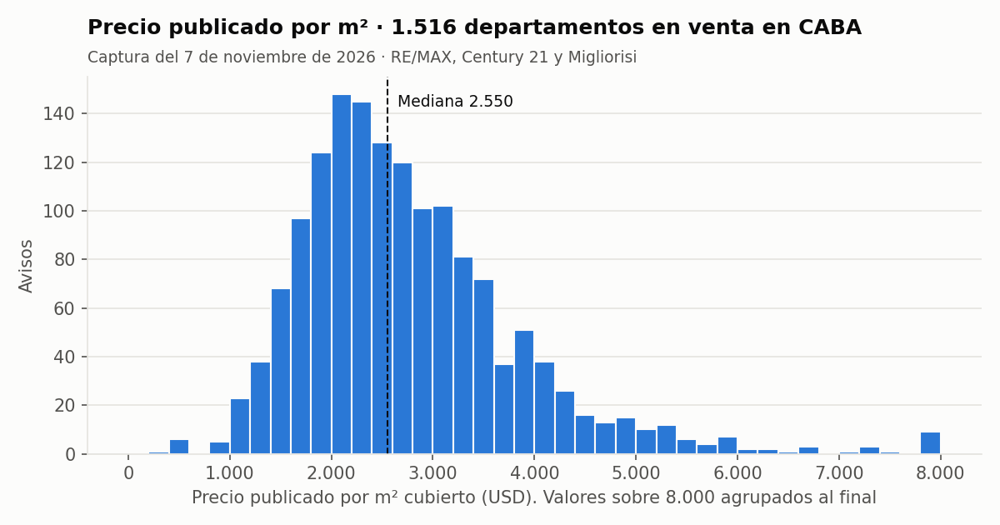
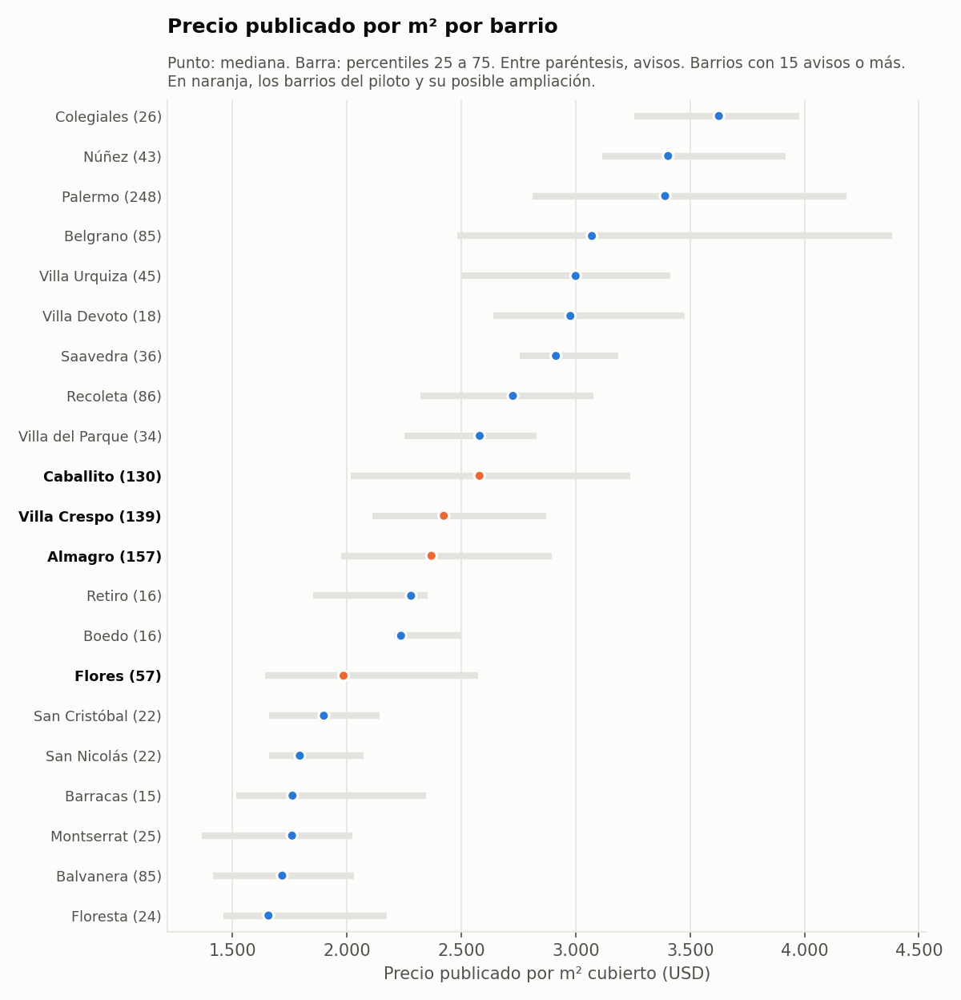
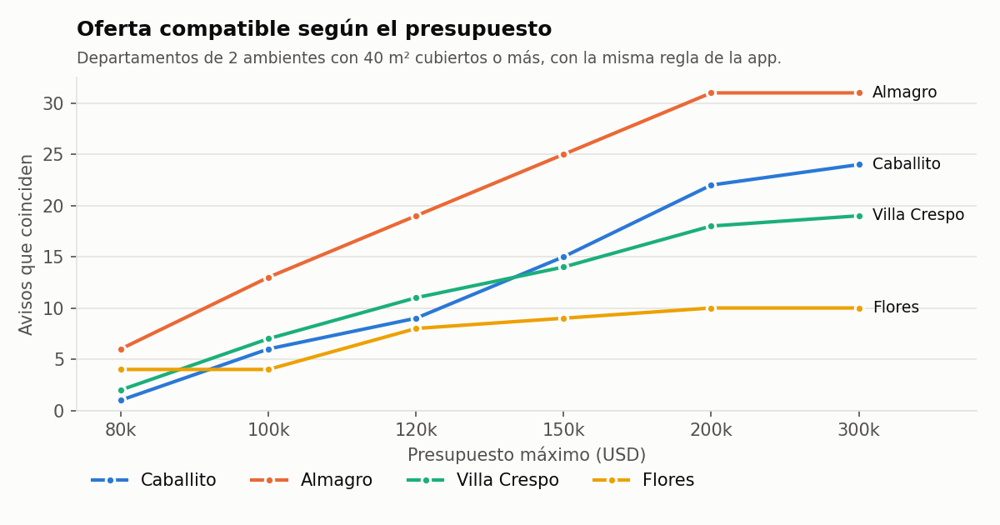

# Informe exploratorio · Avisos de departamentos en venta en CABA

Fuente: catálogo consolidado `inmobiliarias-autorizadas` (RE/MAX, Century 21 y Migliorisi), capturado el 7 de noviembre de 2026 con autorización de cada inmobiliaria. Unidad: aviso vigente de un departamento en venta. Son **precios de publicación**, no tasaciones ni precios de cierre.

## Cómo reproducirlo

```powershell
python -m precio_entorno.eda_avisos data/raw/inmobiliarias-20261107
```

El script aplica la misma validación que la app. Escribe las tablas en `data/processed/avisos/` y los gráficos en `docs/img/eda-avisos/`.

## 1. Calidad y cobertura

| Inmobiliaria | Omitidos por alcance | Capturados | Válidos | % válidos | Con coordenadas | Barrios | Pedidos | Segundos por aviso válido |
| --- | --- | --- | --- | --- | --- | --- | --- | --- |
| RE/MAX | 44 | 600 | 583 | 97,2 % | 582 | 46 | 8 | 0,04 |
| Century 21 | 50 | 600 | 545 | 90,8 % | 540 | 42 | 41 | 0,23 |
| Migliorisi | 26 | 428 | 388 | 90,7 % | 0 | 19 | 472 | 3,64 |
| **Total** | 120 | **1.628** | **1.516** | 93,1 % | 1.122 (74 %) | 48 | 521 | |

- **Omitidos por alcance:** no llegan a la validación. Son emprendimientos o avisos inactivos, avisos fuera de CABA o con barrio ambiguo, y tarjetas que no son departamentos en venta.
- **Descartados en la validación (112):**
  - sin barrio asignable: 59;
  - sin superficie cubierta: 34 faltantes y 3 inválidas;
  - sin precio publicado: 14;
  - moneda faltante o distinta de USD: 11;
  - sin ambientes: 5.
- **Duplicados:** ningún ID se repite. Hay 6 pares de posibles duplicados entre inmobiliarias (mismo barrio, ambientes, m² y precio). Se informan en `registro.json`, pero no se eliminan.
- **Ubicación:** el 74 % trae coordenadas, todas de RE/MAX y Century 21, pero ninguna fuente declara su precisión. Por eso el cruce principal con los delitos es por barrio. Migliorisi no publica coordenadas.
- **Cobertura temporal:** es una sola captura. No hay fecha de publicación comparable entre fuentes, así que no se puede medir cuánto tiempo lleva publicado cada aviso.
- **Costo por aviso apto:** USD 0 en servicios, porque la captura se hizo con Scrapling desde una computadora propia. Los pilotos previos con Apify sobre Zonaprop costaron alrededor de USD 0,0025 y no produjeron avisos, por el bloqueo HTTP 403. El costo real es de tiempo: unos 26 minutos en total, casi todos de Migliorisi, que requiere un pedido por aviso.

## 2. Composición del catálogo

**La oferta observada depende de qué inmobiliarias forman el catálogo.** Migliorisi concentra el 79 % de sus avisos en cuatro barrios cercanos a sus oficinas, y eso infla esos barrios:

| Barrio | RE/MAX | Century 21 | Migliorisi | Total | % Migliorisi |
| --- | --- | --- | --- | --- | --- |
| Palermo | 76 | 77 | 95 | 248 | 38 % |
| Almagro | 29 | 31 | 97 | 157 | 62 % |
| Villa Crespo | 23 | 30 | 86 | 139 | 62 % |
| Caballito | 52 | 53 | 25 | 130 | 19 % |
| Flores | 31 | 22 | 4 | 57 | 7 % |

Los conteos por barrio describen **este catálogo**, no el mercado de CABA. En la app, la comparación de barrios debe leerse como "opciones disponibles en estas inmobiliarias".

## 3. Precios publicados



- **Precio total:** la mediana es de USD 130.000.
- **Precio por m² cubierto:** la mediana es de USD 2.550, con un rango intercuartílico de 2.015 a 3.267. La distribución tiene cola a la derecha.
- **Por ambientes:** el precio por m² baja a medida que crece el departamento.

  | Ambientes | Avisos | Precio mediano | m² cubiertos medianos | USD/m² mediano |
  | --- | --- | --- | --- | --- |
  | 1 | 340 | 92.000 | 33 | 2.833 |
  | 2 | 457 | 117.000 | 43 | 2.640 |
  | 3 | 411 | 155.000 | 64 | 2.411 |
  | 4 | 250 | 229.000 | 98 | 2.324 |
  | 5 o más | 58 | 328.000 | 150 | 2.340 |

- **Valores extremos:** con el criterio de 1,5 rangos intercuartílicos, hay 53 avisos atípicos altos, por encima de 5.145 USD/m², y ninguno bajo. Los altos se concentran en Palermo (19), Belgrano (16) y Puerto Madero (7), y son coherentes con segmentos premium. Los tres más bajos parecen errores de carga y conviene revisarlos a mano:
  - `century21:506534`: 323 m² a USD 110.000;
  - `remax:421841012-145`: USD 14.000 por 30 m²;
  - `remax:421061027-229`: 373 m² a USD 179.000.
- **Superficie cubierta frente a total:**
  - de 1.468 avisos con superficie total, 317 la informan igual a la cubierta, lo que es esperable en departamentos sin balcón;
  - 32 tienen una total de más del doble de la cubierta, posiblemente por terrazas o por errores de carga;
  - la validación anula la superficie total cuando es menor que la cubierta.

## 4. Precios por barrio



21 barrios tienen 15 avisos o más.

| Barrio | Avisos | Precio mediano | USD/m² mediano | USD/m² p25 a p75 | m² medianos |
| --- | --- | --- | --- | --- | --- |
| Caballito | 130 | 147.000 | 2.580 | 2.016 a 3.240 | 56 |
| Villa Crespo | 139 | 125.000 | 2.424 | 2.112 a 2.871 | 52 |
| Almagro | 157 | 118.000 | 2.370 | 1.975 a 2.895 | 46 |
| Flores | 57 | 113.000 | 1.986 | 1.643 a 2.573 | 54 |

- **Extremos:** el precio por m² más alto está en Colegiales (3.626), Núñez (3.404) y Palermo (3.391). El más bajo, en Floresta (1.658), Balvanera (1.718) y Montserrat (1.761).
- **Dispersión:** Belgrano y Palermo tienen la mayor dispersión, porque combinan segmentos muy distintos.
- **Barrios del piloto:** Caballito, Villa Crespo y Almagro quedan en la mitad de la tabla y con precios cercanos entre sí. Flores es unos 400 a 600 USD/m² más barato.

## 5. Oferta según las preferencias



La simulación busca departamentos de 2 ambientes con 40 m² cubiertos o más, con la misma regla que la app: hasta el presupuesto, desde la superficie y con ambientes exactos. Hay 305 avisos con esas características.

| Presupuesto | Almagro | Caballito | Villa Crespo | Flores |
| --- | --- | --- | --- | --- |
| USD 80.000 | 6 | 1 | 2 | 4 |
| USD 100.000 | 13 | 6 | 7 | 4 |
| USD 120.000 | 19 | 9 | 11 | 8 |
| USD 150.000 | 25 | 15 | 14 | 9 |
| USD 200.000 | 31 | 22 | 18 | 10 |

- **Saturación:** la oferta compatible crece rápido hasta unos USD 150.000 a 200.000 y después se estabiliza. Arriba de ese presupuesto, casi todos los 2 ambientes del barrio ya entran.
- **Presupuestos bajos:** con USD 80.000 a 100.000, Almagro y Flores ofrecen más opciones que Caballito. Con USD 120.000, el orden es Almagro (19), Villa Crespo (11), Caballito (9) y Flores (8).
- **Muestras chicas:** cada comparación se apoya en pocos avisos, entre 1 y 31. Con menos de 10 coincidencias, la mediana de precio es inestable. Por la sección 2, la ventaja de Almagro y Villa Crespo refleja en parte el peso de Migliorisi.

## 6. Implicancias

1. **Para el modelo:** el tamaño (1.516 avisos válidos) y la cobertura (48 barrios) cumplen la consigna. Los atípicos bajos deberían revisarse antes de la versión final del modelo. Como la composición del catálogo varía por barrio, conviene incluir la inmobiliaria como variable de control en una prueba de robustez.
2. **Para el producto:** la app muestra cuántos avisos respaldan cada comparación. Sumar más inmobiliarias, sobre todo con presencia en el sur y el oeste, haría la comparación menos dependiente de una sola fuente.
3. **Para las capturas siguientes:** repetir la captura permitiría generar alertas reales y medir altas, bajas y cambios de precio, algo que una sola captura no muestra.
