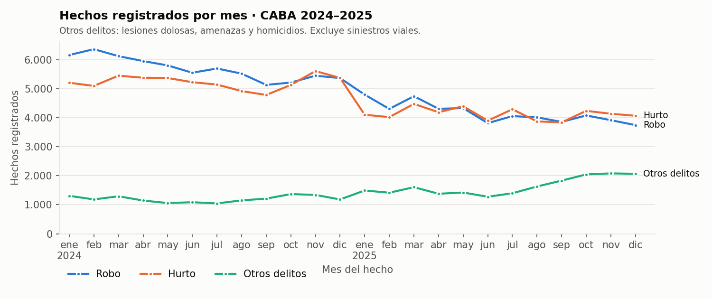
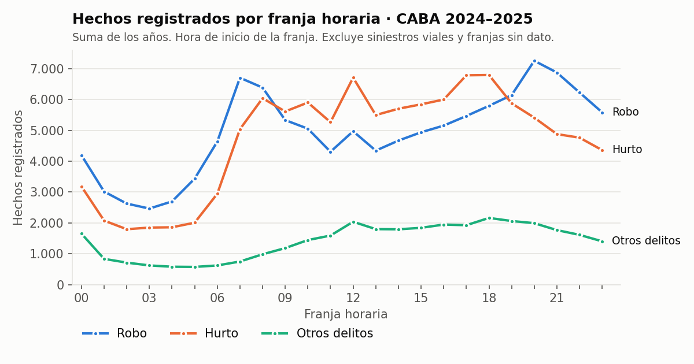
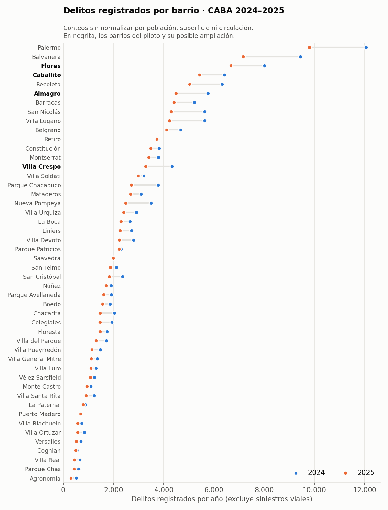

# Informe exploratorio · Delitos registrados en CABA, 2024–2025

**Actualización del mapa, 9/11/2026.** La interfaz ahora analiza [radios alrededor de cada inmueble y persistencia entre años](mapa-registros.md). Los totales por barrio de este informe se conservan como auditoría descriptiva. La [ficha oficial de 2025](https://data.buenosaires.gob.ar/ar/dataset/6976d312-54e9-4398-b721-1504aedcce89/resource/66c0f0f6-e682-403d-abbe-47227d1966fe) advierte que el informe ejecutivo está en revisión por errores detectados. Las comparaciones entre archivos están sujetas a revisión.

Fuente: Mapa del Delito de CABA, [Buenos Aires Data](https://data.buenosaires.gob.ar/dataset/delitos). Unidad: hecho registrado. Período: 1 de enero de 2024 a 31 de diciembre de 2025. Unidad geográfica: barrio (48) y comuna (15). También se usan las coordenadas de cada hecho.

| Archivo | Publicado | SHA-256 |
| --- | --- | --- |
| `delitos_2024.csv` | Junio de 2025 | `0f5df5a362fb600d2123b30acca4f8b87ecf5e4a3ad4411514cf909b376dcea3` |
| `delitos_2025.csv` | Mayo de 2026 | `1ed67c3346eb4f42635cc44bc78e00ec2b023370f1ff6df0e7f309c72a6b45df` |

**No hay datos de 2026.** El catálogo oficial, consultado el 7 de noviembre de 2026, termina en 2025. La Ciudad publica cada año completo en el primer semestre del año siguiente, así que 2026 recién estaría disponible a mediados de 2027.

Los conteos describen hechos **registrados**, no la cantidad real de delitos ni un nivel de seguridad. No están normalizados por población, superficie ni circulación de personas. Por eso un barrio grande, muy poblado o con mucho tránsito acumula más registros.

## Cómo reproducirlo

```powershell
python -m precio_entorno.eda_delitos
```

El script toma todos los `data/raw/delitos_20*.csv` y aplica las mismas reglas de validez que el importador de la app. Cada ID se cuenta una vez por año. Escribe las tablas en `data/processed/delitos/` y los gráficos en `docs/img/eda-delitos/`.

## 1. Calidad y cobertura

| Indicador | 2024 | 2025 |
| --- | --- | --- |
| Filas leídas | 158.838 | 133.203 |
| Filas válidas | 154.916 (97,5 %) | 130.418 (97,9 %) |
| Descartadas (sin barrio ni comuna) | 3.922 | 2.785 |
| IDs duplicados | 0 | 0 |
| Valor de `cantidad` | 1 en todas las filas | 1 en todas las filas |
| Franja sin dato | 41 (todas viales) | 148 (124 amenazas) |
| Pin dentro de CABA | 100 % de las válidas | 100 % de las válidas |
| Hechos en puntos con 10 o más registros | 12,0 % | 13,9 % |

- **Sin repetidos entre archivos:** ningún ID aparece en los dos años.
- **Cobertura:** las 1.152 combinaciones de barrio y mes tienen filas válidas, con un mínimo de 18. No hay barrio y mes sin cobertura. Dentro de una combinación con cobertura, un tipo sin hechos vale **cero registrado**. Por ejemplo, el 89,1 % de las combinaciones tiene cero homicidios dolosos.
- **Los descartes no son aleatorios.** Faltar el barrio se concentra en ciertos tipos, así que esos tipos quedan subrepresentados en el análisis por barrio:

  | Tipo | Descartadas 2024 | Descartadas 2025 |
  | --- | --- | --- |
  | Lesiones | 19,3 % | 12,2 % |
  | Amenazas | 12,2 % | 6,9 % |
  | Siniestros viales | 9,2 % | 3,5 % |
  | Robos y hurtos | 0,1 a 0,2 % | 0,3 % |

- **Pines compartidos:** entre el 12 % y el 14 % de los hechos cae en coordenadas compartidas por 10 o más registros. Parte de los hechos se ubica en puntos de referencia y no en la dirección exacta. Hay que revisarlo antes de contar hechos en radios chicos alrededor de un aviso.

## 2. Composición

| Tipo | 2024 | % | 2025 | % | Variación |
| --- | --- | --- | --- | --- | --- |
| Robo | 68.304 | 47,0 % | 49.938 | 41,9 % | −26,9 % |
| Hurto | 62.655 | 43,1 % | 49.507 | 41,6 % | −21,0 % |
| Lesiones dolosas | 7.606 | 5,2 % | 10.133 | 8,5 % | +33,2 % |
| Amenazas | 6.676 | 4,6 % | 9.416 | 7,9 % | +41,0 % |
| Homicidios dolosos | 78 | 0,05 % | 78 | 0,07 % | 0 % |
| **Delitos** | **145.319** | 100 % | **119.072** | 100 % | **−18,1 %** |
| Siniestros viales (aparte) | 9.597 | | 11.346 | | +18,2 % |

- **Subtipos:** el robo automotor bajó de 1.139 a 524, y el hurto automotor se mantuvo (de 4.650 a 4.537).
- **Lesiones y amenazas:** parte de su suba viene de que en 2025 hubo menos filas sin barrio. Con las filas leídas, antes de validar, la suba es menor: +22,5 % en lesiones y +33,0 % en amenazas.
- **Siniestros viales:** el tipo `Vialidad` corresponde a siniestros viales, no a delitos. Se excluye de los totales de delitos y se informa aparte. El robo implica fuerza o violencia, mientras que el hurto no.

## 3. Evolución mensual



- **Corte entre archivos.** Los robos pasan de 5.364 en diciembre de 2024 a 4.794 en enero de 2025, y los hurtos de 5.370 a 4.101. Una caída tan brusca, justo donde cambia el archivo, puede reflejar diferencias de registro o de procesamiento entre ediciones y no solo un cambio real. Hasta verificarlo con la metodología oficial, la comparación entre años se presenta como descriptiva.
- **Dentro de 2025,** los delitos oscilan entre 8.984 (junio) y 10.820 (marzo) por mes, con un promedio de 9.923. En 2024 el promedio era de 12.110.
- **Lesiones y amenazas** crecen desde agosto de 2025: el total de esos tipos más homicidios pasa de 1.395 en julio a 2.065 en diciembre.
- **Siniestros viales:** suben de 611 en enero de 2024 a alrededor de 1.000 desde fines de 2024 y se mantienen en ese nivel durante 2025. Parece un cambio de nivel, posiblemente de registro, más que una tendencia.

## 4. Franja horaria



- Los robos tienen dos picos, a las 7 h y a las 20 h, que es el máximo.
- Los hurtos se concentran durante el día, con máximos a las 12 h y entre las 17 y las 18 h.
- El mínimo de ambos tipos está entre las 2 y las 4 h.
- La franja nocturna, de 20 a 5 h, reúne el 33,4 % de los delitos de los dos años. El patrón horario es parecido en ambos años: la mediana por barrio de la proporción nocturna es 32,0 % en 2024 y 32,2 % en 2025.

## 5. Barrios



| Barrio | Año | Delitos | Puesto (de 48) | Robos | Hurtos | Lesiones | Amenazas | Con arma | Con moto | Nocturnos |
| --- | --- | --- | --- | --- | --- | --- | --- | --- | --- | --- |
| Flores | 2024 | 8.010 | 3 | 4.079 | 3.153 | 444 | 327 | 6,1 % | 3,1 % | 30,0 % |
| | 2025 | 6.675 | 3 | 3.128 | 2.231 | 747 | 560 | 5,0 % | 4,5 % | 29,1 % |
| Caballito | 2024 | 6.421 | 4 | 2.950 | 2.951 | 267 | 251 | 2,7 % | 4,8 % | 31,4 % |
| | 2025 | 5.427 | 4 | 2.381 | 2.343 | 338 | 363 | 2,2 % | 5,7 % | 32,4 % |
| Almagro | 2024 | 5.760 | 6 | 3.103 | 2.190 | 257 | 207 | 2,5 % | 6,1 % | 37,8 % |
| | 2025 | 4.482 | 6 | 2.108 | 1.728 | 325 | 321 | 2,3 % | 5,2 % | 38,9 % |
| Villa Crespo | 2024 | 4.330 | 11 | 1.968 | 2.033 | 166 | 161 | 2,5 % | 6,2 % | 40,6 % |
| | 2025 | 3.269 | 14 | 1.306 | 1.557 | 203 | 197 | 2,2 % | 6,5 % | 36,4 % |

- **Todos los barrios bajan entre años.** Las variaciones van de −42 % en Agronomía a −1 % en Retiro, Saavedra y Puerto Madero, con una mediana de −17 %. Como la caída es general, probablemente sea en parte el corte entre archivos de la sección 3.
- **El orden se mantiene.** Palermo, Balvanera, Flores y Caballito encabezan los conteos absolutos en los dos años. Ese orden sigue en buena medida al tamaño y al movimiento de cada barrio, así que no es una comparación de riesgo.
- **El uso de armas varía mucho más que el total.** En 2025, Villa Soldati (16,4 %) y Villa Lugano (11,5 %) superan con creces la mediana de los barrios (3,8 %). Caballito y Almagro tienen alrededor del 2 %. Las proporciones son más comparables entre barrios que los conteos absolutos.
- **Caballito y Almagro,** los barrios del piloto, tienen volúmenes similares, pero distinta composición. Caballito tiene tantos hurtos como robos. Almagro tiene más robos y una proporción nocturna más alta, cercana al 38 %.

## 6. Dataset candidato · `barrio_mes.csv`

Hay una fila por barrio y mes con cobertura en el archivo: **1.152 filas** (48 barrios por 24 meses), dentro de la meta de 700 a 2.000 registros. Una combinación sin filas válidas no se completaría con ceros.

| Variable | Definición |
| --- | --- |
| `barrio`, `comuna`, `mes` | Barrio oficial de CABA, comuna más frecuente del barrio y mes del hecho (AAAA-MM) |
| `filas_validas` | Filas válidas que respaldan la combinación (cobertura) |
| `robos`, `hurtos` | Hechos de cada tipo, incluidos los subtipos automotor |
| `automotor` | Robos y hurtos de automotor |
| `lesiones_dolosas`, `amenazas`, `homicidios_dolosos` | Hechos de cada tipo |
| `delitos_con_arma`, `delitos_con_moto` | Delitos con `uso_arma` o `uso_moto` igual a SI |
| `delitos_nocturnos` | Delitos en franjas de 20 a 5 h |
| `total_delitos` | Suma de los delitos, sin siniestros viales |
| `siniestros_viales` | Lesiones y muertes por siniestros viales, aparte |

`barrio_anio.csv` resume los mismos conteos por barrio y año, con las proporciones con arma, con moto y nocturnas.

## 7. Implicancias para el cruce y el modelo

1. **Ventana temporal.** Para avisos capturados en 2026, 2025 es el año previo publicado. El mapa lo contrasta con 2024 para observar persistencia, manteniendo separados los conteos de cada año y el desfase respecto del aviso. El corte entre archivos de la sección 3 y la revisión del informe ejecutivo de 2025 limitan la interpretación. No se presenta la comparación como evidencia de cambio del riesgo individual.
2. **Variables por barrio y variable `barrio`.** Una variable de delitos por barrio vale lo mismo para todos los avisos del barrio. Si el modelo inmobiliario ya incluye el barrio, el modelo con entorno no puede mejorar el error. Para medir un aporte real hay dos opciones:
   - usar variables que cambien dentro del barrio, como los hechos en un radio alrededor del pin cuando la precisión del aviso lo permita;
   - que el modelo inmobiliario use comuna o coordenadas en lugar de barrio.
3. **Cruce por coordenadas.** Todas las filas válidas de estas ediciones tienen un pin dentro del rectángulo aproximado de CABA. La app conserva latitud, longitud y precisión informada del aviso y habilita radios de 250, 500 y 1.000 m si la precisión es de hasta 100 m. Los pines compartidos de la sección 1 siguen siendo una limitación; no se reemplazan ubicaciones faltantes por centroides de barrio.
4. **Tipos con descartes altos.** Lesiones y amenazas pierden entre el 7 % y el 19 % de sus filas por falta de barrio. Conviene construir las variables del modelo con robos y hurtos, que casi no tienen descartes, y tratar lesiones y amenazas como secundarias.
5. **Normalización.** Para comparar barrios hace falta la superficie o la población de cada uno, que estos archivos no traen. El dataset de barrios de Buenos Aires Data, con sus geometrías, permitiría calcular hechos por km². Mientras tanto, las proporciones (con arma, nocturnos, por tipo) son más comparables que los conteos.
6. **Lenguaje.** Los resultados se presentan como hechos registrados, con su período y unidad geográfica. No se construye un puntaje de seguridad.
