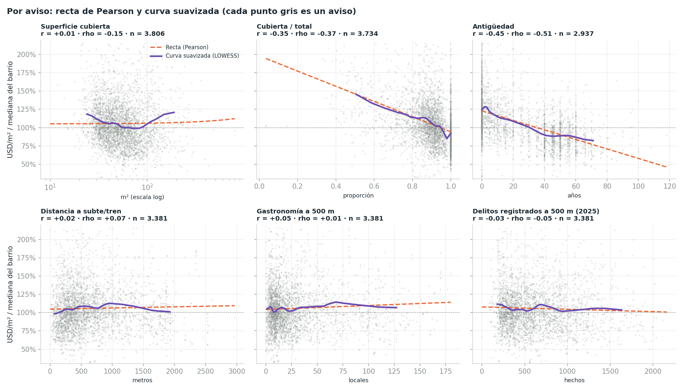
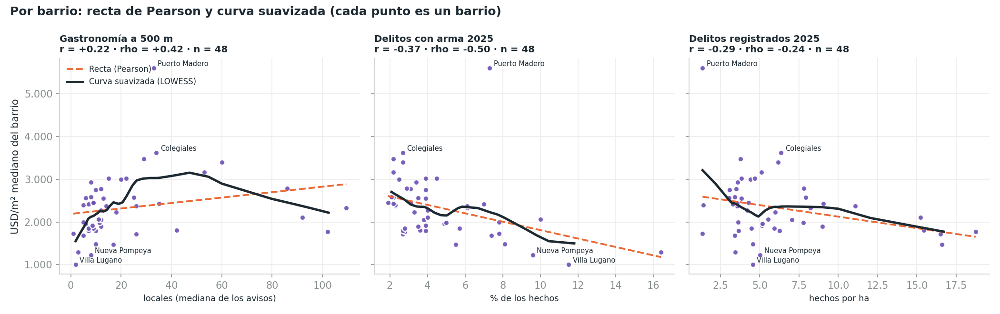

# Precio y Entorno CABA · Entrega asincrónica del 10/11/2026

**Equipo:** [completar integrantes]. **Alcance:** avisos de departamentos en venta en CABA, con precio publicado en USD. La decisión de producto es cómo ayudar a una inmobiliaria a encontrar opciones relevantes para sus compradores, comparar barrios y enterarse de nuevas coincidencias.

## 1. Correlaciones lineales y no lineales

**Datos.** Captura consolidada del 7 al 9 de noviembre de 2026, con 3.806 avisos válidos en 48 barrios. El Mapa del Delito aporta hechos registrados de enero a diciembre de 2025. Las variables adicionales de entorno del notebook, como gastronomía, escuelas y ruido, se usan como análisis exploratorio complementario.

**Método.** Pearson resume asociaciones lineales. Spearman mide si los valores tienden a ordenarse en el mismo sentido o en sentido opuesto, incluso cuando la relación es curva y monotónica. Las dispersiones comparan una recta con una curva suavizada (LOWESS), que permite ver cambios de pendiente y posibles relaciones no monotónicas. Cada coeficiente usa únicamente las filas con ambos datos. Las tablas completas y el procedimiento se reproducen con el [notebook del EDA](../notebooks/eda_oportunidades.ipynb).

### Por aviso
La respuesta es el **precio publicado en USD por m² cubierto, dividido por la mediana de su barrio**. Un valor de 1,10 equivale a un 10 % por encima de esa mediana. Este ajuste descriptivo reduce diferencias de nivel entre barrios.

| Variable | n | Faltantes | Pearson | Spearman |
| --- | ---: | ---: | ---: | ---: |
| Antigüedad en años | 2.937 | 22,8 % | −0,45 | −0,51 |
| Proporción cubierta / total | 3.734 | 1,9 % | −0,35 | −0,37 |
| Superficie cubierta en m² | 3.806 | 0,0 % | +0,01 | −0,15 |
| Cocheras | 2.526 | 33,6 % | +0,25 | +0,22 |
| Expensas en ARS por m² y mes | 1.606 | 57,8 % | +0,30 | +0,27 |
| Delitos registrados a 500 m del pin en 2025 | 3.381 | 11,2 % | −0,03 | −0,05 |

La antigüedad tiene la asociación negativa más marcada de las variables examinadas. La superficie cubierta tiene una asociación lineal casi nula y una asociación por rangos débil. Conviene leer su curva por tramos antes de resumirla con un solo número. La superficie también forma parte del denominador de USD/m², lo que limita la interpretación de esa asociación. Las expensas solo están disponibles para cuatro de cada diez avisos. El conteo de delitos a 500 m muestra una asociación muy débil en esta muestra y usa pines de precisión variable.

### Por barrio

La respuesta es la **mediana de USD/m² publicado del barrio**. Cada punto representa un barrio, con 48 observaciones completas por variable en esta tabla.

| Variable | n | Pearson | Spearman |
| --- | ---: | ---: | ---: |
| Hechos con arma en 2025, como % de los hechos del barrio | 48 | −0,37 | −0,50 |
| Delitos registrados en 2025 por hectárea del barrio | 48 | −0,29 | −0,24 |
| Locales gastronómicos a 500 m, mediana de los avisos con pin | 48 | +0,22 | +0,42 |
| Estaciones de subte por 100 ha | 48 | −0,20 | ≈0,00 |

La asociación por rangos con gastronomía es más marcada que la lineal en el agregado. Es un resultado a nivel barrio. Por aviso, gastronomía tiene Pearson +0,05 y Spearman +0,01. Los patrones entre barrios pueden reflejar diferencias en la composición de la oferta, la actividad urbana o la cobertura de los datos. Estas asociaciones son descriptivas. La prueba de utilidad predictiva requiere comparar modelos en la misma partición y medir su error sobre avisos fuera del entrenamiento.

## 2. Métricas tentativas

| Tipo | Métrica | Cálculo y justificación |
| --- | --- | --- |
| Negocio · principal | Minutos ahorrados por búsqueda | Mediana de las diferencias por búsqueda entre los minutos del método habitual y los del prototipo. Usar los mismos filtros y el mismo criterio de relevancia. Mide el trabajo que buscamos reducir. |
| Negocio · complemento | Utilidad de las alertas | Alertas que la persona compartiría con el comprador / alertas revisadas. Mostrar también el denominador y los motivos de descarte. |
| Negocio · complemento | Opciones relevantes encontradas | Contar las opciones que la persona considera relevantes en cada método. Ayuda a detectar si el ahorro de tiempo se consigue a costa de encontrar menos opciones. |
| Operación | Enlaces activos al revisar | Fichas verificadas como publicadas y disponibles / fichas revisadas. Informar por separado cuántas quedaron sin confirmar. Mide la frescura de lo que recibe la inmobiliaria. |
| Análisis | MAE en USD/m² | Promedio del error absoluto en avisos de prueba. Comparar la mediana de comparables, un modelo inmobiliario y el mismo modelo con indicadores de delitos, usando la misma partición. |
| Calidad de datos | Tasa de aceptación y cobertura | Avisos válidos / avisos leídos, más barrios cubiertos y completitud por campo. Permite detectar cambios en la calidad de las fuentes y saber dónde interpretar los resultados con más cautela. |

El [protocolo de validación](validacion-inmobiliaria.md) propone comparar ambos métodos en 5 a 10 búsquedas, alternando el orden. El tiempo ahorrado y la utilidad de alertas quedan pendientes de medir con una inmobiliaria.

## 3. Diseño del ETL y preprocesamiento

**Flujo:** catálogo autorizado de avisos y CSV anual del Mapa del Delito → adaptación y validación por fuente → normalización y deduplicación → SQLite y salidas analíticas → EDA, dashboard y alertas.

| Paso | Función o regla | Salida |
| --- | --- | --- |
| Extraer | Adaptadores por fuente y exportaciones de Apify. Conservar solo los campos del contrato. | Lote con ID de origen y fecha de captura, más un registro de filas omitidas. |
| Limpiar | `importing.parse_listings` valida ID, fecha, URL, barrio, moneda, precio, superficie cubierta y ambientes. En venta acepta USD, entre 10 y 2.000 m² cubiertos y entre 200 y 20.000 USD/m². | Avisos válidos y conteo de rechazos. |
| Normalizar | Unificar alias al barrio oficial y formatos de moneda, números y etiquetas de la propiedad. Las subzonas ambiguas se omiten. | Variables comparables entre fuentes, con sus unidades. |
| Tratar nulos | Descartar avisos con campos obligatorios faltantes o inválidos. Conservar opcionales como nulos. En delitos, descartar hechos sin barrio y conservar la franja ausente como desconocida. | Cobertura explícita por campo y fuente. |
| Deduplicar y cargar | Usar ID con prefijo de fuente. Marcar los posibles duplicados entre fuentes sin borrar las filas. En delitos, usar año e ID de mapa. | Una fila operativa por ID. Reimportar el mismo lote no genera nuevas alertas. |
| Mantener vigencia | `Store.ingest` registra reapariciones y cambios de precio. La ausencia solo modifica el estado cuando el barrido de la fuente fue completo. Dos barridos completos consecutivos sin encontrar el aviso pueden darlo de baja. | Historial de precios publicados, última observación y estado del aviso. Una captura parcial no acredita una baja. |
| Preparar análisis | Calcular USD/m² cubierto y su relación con la mediana barrial. Agregar hechos registrados de 2025 por barrio y documentar los análisis a 500 m como exploratorios cuando el pin tenga precisión incierta. | Tablas por aviso y por barrio, figuras y datasets para evaluar el modelo. |

La [corrida reproducible del ETL](etl.md) leyó **4.007 avisos**, aceptó **3.806 (95,0 %)** y descartó **201**. Identificó **446 avisos en 221 grupos** de posibles duplicados entre fuentes. Al repetir el lote, produjo **0 avisos nuevos y 0 alertas nuevas**. Del CSV oficial de delitos de 2025 ingresaron **130.418 de 133.203 registros**. Los **2.785 restantes** no tenían barrio asignable.

En la implementación actual, `no_visto` sigue contando en el mapa y las medianas hasta que el aviso pasa a `baja`. Los barridos parciales de Zonaprop dejan intacta la vigencia. La verificación selectiva de fichas en esa fuente queda pendiente. Una baja describe la publicación y no permite saber si hubo una venta.

## 4. Práctica del dashboard para BIZ

1. Abrir la interfaz de venta y fijar un presupuesto, superficie y ambientes. Comparar **Caballito y Almagro** con los mismos filtros.
2. Leer cuántos avisos coinciden y cómo se distribuyen sus precios publicados. Identificar en qué barrio conviene empezar a revisar opciones. Mostrar el período y la unidad de la capa de hechos registrados cuando se active.
3. Abrir la ficha de un barrio y guardar la búsqueda. En modo ficticio, cargar un lote nuevo y comprobar si se genera la alerta correspondiente. Reimportar el lote para mostrar que la alerta no se repite.
4. Explicar un hallazgo del EDA y una limitación. Por ejemplo, la asociación con antigüedad tiene 22,8 % de faltantes, y la comparación por barrio usa solo 48 observaciones.

La [guía del flujo de trabajo](flujo-de-trabajo.md) detalla el arranque y las pantallas. Las tablas se pueden regenerar con el notebook y el reporte de calidad con `python -m precio_entorno.etl_reporte`, usando los archivos locales. Los datos ficticios se usan exclusivamente en la demo de alertas y en las pruebas.
