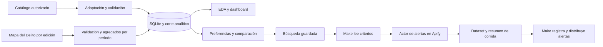

# Precio y Entorno CABA · Producto 1 — Analytics

Entrega prevista para el 12 de noviembre de 2026. Auditoría realizada el 10/11/2026 sobre la revisión `1ec95710a8296235940cb61cffc99d408a58542e` y los archivos de entrega indicados en el manifiesto. **Integrantes, comisión y líder:** completar antes de presentar.

## 1. Propuesta y alcance de la entrega

El producto ayuda a una inmobiliaria de CABA a gestionar búsquedas de compradores. La persona ingresa preferencias, compara barrios bajo los mismos filtros, guarda una búsqueda y recibe una alerta cuando se incorpora un aviso compatible. Analytics permite describir la oferta, la distribución de precios publicados y el contexto geográfico para decidir dónde empezar a revisar opciones.

La entrega principal usa departamentos en venta publicados en USD. Integra un catálogo autorizado con trazabilidad de los portales de origen y el Mapa del Delito de CABA. Alquiler, capas urbanas y radar editorial ya tienen implementación, pero se presentan como extensiones. Los conteos del radar describen cobertura periodística y aperturas reportadas, y se mantienen fuera de las tablas de avisos y delitos. El precio de publicación y la disponibilidad observada son los datos comerciales que el proyecto puede respaldar.

**Estado de preparación.** El ETL, el EDA, el recorrido del producto y los contratos de alertas cuentan con evidencia local. Make tiene dos escenarios activos. La entrega todavía requiere una evidencia remota completa que conecte Analytics con su salida, además de los datos del equipo y la devolución real de Diana. El Actor implementado produce alertas. El Actor comercial con operaciones `analytics` e `inference` sigue siendo un pendiente explícito de integración.

## 2. Matriz de cumplimiento

La etiqueta «verificado local» significa que se inspeccionó el código, una salida reproducida o una prueba. «Activo» describe el estado consultado en Make y no certifica la entrega de un correo.

| Requisito | Evidencia del proyecto | Estado y criterio para cerrar |
| --- | --- | --- |
| Problema, rubro, usuario y competencia | [Investigación de mercado](fase-1-mercado-competitividad.md), [brainstorming](brainstorming-capstone.md) | Documentados. Las hipótesis sobre hábitos y disposición a pagar necesitan entrevistas. Conservar las fechas del benchmark. |
| Fuentes y permiso | [Inventario](datos.md), [pedidos de acceso](pedidos-de-acceso.md), registros de captura | Procedencia documentada. SE debe tener localizables los permisos para enseñarlos, ocultando contactos en la presentación. |
| ETL y calidad | [Diseño del ETL](etl.md), `data/processed/etl/reporte.json` | Verificado local. 4.007 avisos leídos, 3.806 aceptados y 201 descartados. Lote inválido y reimportación reproducidos. |
| Normalización, nulos y duplicados | `importing.py`, `store.py`, [ETL](etl.md) | Cubiertos por pruebas. Campos obligatorios inválidos se rechazan, opcionales se conservan como nulos. Los posibles duplicados entre fuentes se agrupan. |
| Muestras analíticas y diccionario | [Manifiesto](../data/processed/entrega-12-11/manifest.json), diccionario de esta entrega | Preparadas. 1.800 avisos y 1.152 filas barrio-mes, con diez campos cada una. La selección balanceada por barrio limita la extrapolación al mercado. |
| EDA, correlaciones y hallazgos | [Entrega del 10/11](entrega-10-11.md), [EDA de avisos](eda-avisos.md), [notebook](../notebooks/eda_oportunidades.ipynb) | Resultados existentes. Distinguir el universo de 3.806 avisos de la muestra de entrega de 1.800. Las correlaciones del 10/11 conservan su universo original. |
| Dashboard y comparación | `web/`, `api.py`, [guía](ui.md) | API verificada en copias temporales. Faltan ensayo visual en el equipo de presentación y evidencia de las pantallas finales. |
| Búsqueda guardada y alerta nueva | `test_demo.py`, `test_actualizar.py`, `test_actor_alertas.py` | Verificado con datos ficticios y servicios simulados. La reimportación no duplica alertas. |
| Make y Apify | `actor_main.py`, `.actor/`, `make_escenarios.py`, [arquitectura](arquitectura.md#81-actor-de-alertas) | Consulta del 10/11 confirmó activos «Búsquedas» y «Alertas con Apify». Falta adjuntar corrida remota, salida y resultado del destinatario para cerrar punta a punta. |
| Automatización de Analytics | ETL y notebook locales; Actor actual orientado a alertas | Pendiente prioritario. Documentar cómo un corte de datos pasa desde la ejecución orquestada al resultado analítico y al dashboard, con una evidencia de ejecución. |
| Errores y vigencia | `test_vigencia.py`, `test_make_webhook.py`, `test_actor_alertas.py` | Verificado local. Capturas parciales no acreditan una baja. Registrar qué ruta operativa se demuestra. |
| Negocio y métricas | [Protocolo](validacion-inmobiliaria.md), [pricing](pricing.md) | Diseñados. Ahorro de tiempo, utilidad y pago permanecen pendientes de validación real. |
| Mensaje de Diana y alcance de Producto 2 | Registro de pedidos de la sección 9 | Por completar con el mensaje del 12/11. El líder lleva la respuesta a la gerente. |

## 3. Datos, versiones y calidad

| Conjunto | Tamaño y período | Uso y límite |
| --- | --- | --- |
| Base operativa de venta | 3.820 avisos, 48 barrios, consultada el 10/11 | Sirve a la interfaz. Todos figuran como activos, lo que registra el estado interno y no certifica una revisión reciente de cada ficha. |
| Corte ampliado del EDA | 3.806 avisos válidos de capturas del 7 al 9/11 | Base del notebook y las correlaciones. Su volumen difiere de la base operativa por las versiones y actualizaciones posteriores. |
| Muestra de entrega de venta | 1.800 avisos, diez campos, 48 barrios | Un representante por grupo aproximado, seleccionado por ID estable, y rondas por barrio con orden hash reproducible. Entre 20 y 38 avisos por barrio según disponibilidad. |
| Serie histórica de delitos | 1.152 filas de 48 barrios × 24 meses, 2024–2025 | Diez campos agregados. Permite revisar cobertura y composición. Para el cruce con avisos de noviembre de 2026 se usa 2025, con diez meses de desfase entre el cierre del año y el inicio del mes de captura. |
| Base de alquiler | 3.272 avisos, 48 barrios, consultada el 10/11 | Extensión operativa. Conserva ARS y USD como monedas de publicación separadas. |

La muestra de venta selecciona 1.800 de los 3.582 grupos aproximados que existen en el paquete del EDA. La agrupación puede reunir inmuebles distintos con características parecidas, por lo que se informa el criterio y se conserva el universo original para auditar. La selección balanceada sirve a la comparación barrial. Las medianas del universo ampliado y de esta muestra tienen poblaciones distintas.

El ETL aceptó el 95,0 % de los avisos leídos. Detectó 446 avisos en 221 grupos de posibles duplicados durante la corrida. El paquete histórico del modelo tiene 3.582 grupos sobre 3.806 filas y usa su propia versión de agrupación. Esas cifras corresponden a artefactos distintos. Al repetir el lote del ETL se obtuvieron 0 filas nuevas y 0 alertas nuevas. Las 15 alertas de la primera ingesta pertenecen a una búsqueda de prueba en una base temporal.

Del CSV de delitos de 2025 se aceptaron 130.418 de 133.203 registros. Se descartaron 2.785 sin barrio. Estos conteos son filas procesadas. Los indicadores del EDA suman el campo de cantidad de hechos cuando corresponde. La ficha oficial informa que el **informe ejecutivo de 2025 está en revisión por errores detectados**. Esta advertencia afecta la confianza con la que se presentan las comparaciones y exige conservar la edición y sus hashes. Los resultados se mantienen como contexto descriptivo sujeto a esa revisión. [Ficha oficial consultada el 10/11/2026](https://data.buenosaires.gob.ar/ar/dataset/6976d312-54e9-4398-b721-1504aedcce89/resource/66c0f0f6-e682-403d-abbe-47227d1966fe)

### Diccionario de la muestra de venta

Todos los campos seleccionados están completos. La decisión de seleccionar campos completos no elimina los faltantes del catálogo completo, que se detallan en [ETL](etl.md).

| Campo | Tipo y unidad | Origen o transformación |
| --- | --- | --- |
| `id` | Texto | ID estable del aviso con prefijo de fuente. |
| `captured_at` | Fecha/hora ISO | Momento de la captura, conservado en el paquete analítico. |
| `neighborhood` | Categoría | Barrio oficial normalizado de CABA. |
| `price` | Número, USD | Precio de publicación validado. |
| `currency` | Categoría, USD | Moneda publicada en el corte de venta. |
| `covered_area` | Número, m² | Superficie cubierta validada. |
| `rooms` | Entero, ambientes | Cantidad publicada y validada. |
| `precio_m2` | Número, USD/m² | Precio dividido por superficie cubierta. |
| `agency` | Categoría | Fuente identificada a partir del prefijo del ID. |
| `grupo` | Texto | Grupo aproximado de posibles duplicados del paquete del modelo. |

### Diccionario de la serie barrio-mes

Cada clave `barrio` + `mes` es única. Los valores cero son conteos resultantes del procesamiento de la edición local, con cobertura por barrio-mes. La cobertura y el registro condicionan su interpretación.

| Campo | Tipo y unidad | Definición |
| --- | --- | --- |
| `barrio` | Categoría | Barrio oficial. |
| `mes` | Período AAAA-MM | Mes del hecho registrado. |
| `filas_validas` | Entero, filas | Filas válidas asignadas a ese barrio y mes. |
| `robos` | Entero, hechos | Cantidad de robos de las categorías del ETL. |
| `hurtos` | Entero, hechos | Cantidad de hurtos. |
| `amenazas` | Entero, hechos | Cantidad de amenazas. |
| `lesiones_dolosas` | Entero, hechos | Cantidad clasificada como lesiones dolosas. |
| `homicidios_dolosos` | Entero, hechos | Cantidad clasificada como homicidios dolosos. |
| `total_delitos` | Entero, hechos | Suma de categorías delictivas del ETL, excluyendo siniestros viales. |
| `siniestros_viales` | Entero, hechos | Conteo separado del total delictivo. |

## 4. Hallazgos y decisiones para el usuario

1. **El presupuesto tiene distinta cobertura según el barrio.** El corte ampliado tiene una mediana de publicación de USD 119.900 y de 2.411 USD/m². La muestra por barrio y la cobertura de las fuentes condicionan esos valores. La acción es aplicar los mismos filtros a Caballito y Almagro y revisar las coincidencias efectivas de cada uno.
2. **La composición del catálogo cambia la comparación.** Incorporar barrios y fuentes modifica las medianas. Por eso se muestra corte, fuente y tamaño antes de comparar valores de dos corridas.
3. **Hay campos que requieren cautela.** En el EDA por aviso, antigüedad tiene 22,8 % de faltantes y expensas por m², 57,8 %. La asociación de antigüedad con el precio por m² relativo al barrio es Pearson −0,45 y Spearman −0,51. Es una señal exploratoria que requiere controlar otras características.
4. **La correlación cambia con la escala.** Gastronomía tiene Spearman +0,42 entre barrios y +0,01 entre avisos con el ajuste del EDA. Una comparación barrial no describe automáticamente lo que sucede con cada inmueble. Las curvas suavizadas complementan la lectura de Pearson y Spearman.
5. **La disponibilidad condiciona la utilidad de una alerta.** El historial registra precio y última observación. Una captura parcial conserva el estado del aviso. Dos ausencias en barridos completos pueden producir la baja, con un freno si falta más del 30 % de los vigentes de la fuente. `no_visto` todavía cuenta como vigente. La verificación selectiva de Zonaprop sigue pendiente.

Los gráficos de Pearson, Spearman y las curvas LOWESS están en la [entrega del 10/11](entrega-10-11.md). Corresponden a sus universos originales de 3.806 avisos y 48 barrios. Las muestras reducidas adjuntas permiten revisar datos y cobertura, y requieren volver a calcular los coeficientes si se quieren presentar resultados exclusivos de esas muestras.

## 5. Arquitectura, automatización y operación

El flujo remoto confirmado tiene los escenarios **«Precio y Entorno CABA - Búsquedas»** y **«Precio y Entorno CABA - Alertas con Apify»**, activos al consultar su estado el 10/11. Make gestiona el alta y la baja de suscripciones, lee los criterios, ejecuta el Actor y distribuye sus resultados. Los correos de suscriptores se guardan en la planilla de Make. El Actor recibe criterios sin correos y conserva IDs vistos en el almacenamiento de Apify. Su primera corrida crea una línea de base salvo configuración explícita para alertar.

También existe la actualización local con registro en `actualizaciones.jsonl`. Ambos caminos tienen persistencias diferentes. Antes de la demo, SE debe identificar cuál se muestra, sus búsquedas, su registro y su criterio de novedad. No se debe asumir que el almacén remoto de IDs y la base SQLite se sincronizan automáticamente.

La captura y las alertas están orquestadas. La generación del corte analítico, el EDA y el notebook tienen ejecución local reproducible. Para acreditar automatización integral de Analytics falta conservar una corrida que documente la conexión entre esas etapas y la actualización de su resultado. El contrato comercial `operation=analytics` / `operation=inference` no figura en la entrada del Actor actual.

## 6. Guion de demostración y recuperación

Ensayo interno propuesto de diez minutos. Ajustar la duración a la indicación de la profesora para el 12/11.

| Tiempo | Rol | Acción y evidencia |
| --- | --- | --- |
| 0:00–1:00 | BIZ | Presentar el problema de seguimiento de búsquedas, el usuario y la métrica de minutos netos por revisión. |
| 1:00–3:00 | DS | Abrir el reporte del ETL. Mostrar aceptación, rechazos, lote inválido y reimportación sin duplicar. Explicar versión operativa, universo EDA y muestra de entrega. |
| 3:00–5:00 | BIZ + DS | Abrir la web con datos reales. Aplicar USD 130.000, 40 m² y dos ambientes a Caballito y Almagro. Explicar coincidencias y una limitación del contexto de 2025. Abrir el notebook para mostrar precio/m² y curvas. |
| 5:00–7:00 | SE | Mostrar los dos escenarios y una evidencia existente de corrida de Apify, entrada de criterios, dataset, OUTPUT y registro de Make. Si falta esa evidencia, presentarlo como pendiente sin declarar una entrega de correo verificada. |
| 7:00–9:00 | SE | Con datos ficticios y base temporal, guardar una búsqueda, ingresar un aviso compatible y repetir el lote. Mostrar alerta única. Mostrar una entrada inválida y cómo se informa el error. |
| 9:00–10:00 | Líder | Cerrar con los límites, los tres pedidos de Diana y el alcance propuesto para Producto 2. |

**Preparación local.** Abrir la web con `python -m precio_entorno.api` en http://127.0.0.1:8000. Las capas locales ya existen. Streamlit se abre con `python -m streamlit run app.py`. Mantener a mano el notebook, los dos gráficos y el reporte JSON. El ensayo HTTP confirmó respuesta 200 para la portada, estado, barrios y fuentes con copias temporales de las bases. La revisión visual de la pantalla final sigue pendiente.

**Si falla la red.** Mostrar el reporte, CSV, notebook y pruebas locales. Identificar la evidencia remota como histórica con su fecha. **Si falla una fuente.** Mostrar el estado parcial y el registro, conservando la distinción entre ausencia y baja. **Si falla Make.** Mostrar dataset/OUTPUT y el estado del envío, registrar el incidente y evitar reenviar una corrida completa sin revisar lo ya procesado. El ensayo que envía correos requiere una acción explícita del equipo con destinatario y costo conocidos.

## 7. Administración de trabajo y riesgos

Las asignaciones siguientes son por rol. El líder debe completarlas con nombres y hora de cierre. P0 afecta la afirmación de cumplimiento de la entrega. P1 mejora la evidencia y la exposición.

| Prioridad y fecha propuesta | Responsable | Acción | Criterio de cierre |
| --- | --- | --- | --- |
| P0 · 11/11 | SE | Reunir evidencia remota de Make y Apify, preferentemente de una ejecución ya existente | ID y fecha de corrida, estado, conteos, OUTPUT y destino revisado, con contactos ocultos. |
| P0 · 11/11 | SE + DS | Cerrar la trazabilidad de Analytics automatizado y acordar su relación con el Actor de dos operaciones | Diagrama real, comando o configuración, corrida y salida analítica identificables. Si requiere más trabajo, declarar el alcance parcial y su fecha de cierre. |
| P0 · 11/11 | Líder + BIZ | Completar integrantes, ficha de Diana, feedback del 5/11 y confirmación del segmento | Registro real y acuerdos localizables. |
| P1 · 11/11 | DS | Revisar muestras, manifiesto y advertencia de delitos con quien presenta | Poder explicar 3.820 / 3.806 / 1.800, los grupos y el corte 2025. |
| P1 · 11/11 | BIZ + SE | Ensayar las pantallas y preparar evidencia visual | Se ve fuente, modo, fecha, moneda, filtros y resultado. |
| P1 · 11/11 | BIZ | Ensayar una decisión con métricas y límites | Comparación barrial comprensible y protocolo de validación preparado. |
| P0 · 12/11 | Líder | Registrar pedidos y negociar alcance de Producto 2 | Tres pedidos literales, clasificación, respuesta, responsable y acuerdo. |

En Trello, adjuntar este informe y la evidencia a las tarjetas existentes de datos, dashboard y automatización. El [tablero documentado](tablero-trello.md) sirve como referencia de organización. Esta auditoría no modificó su estado remoto.

**Riesgos principales.** La rotación de fuentes puede afectar la cobertura y la vigencia. El modelo y las correlaciones pueden capturar diferencias entre inmobiliarias. Una muestra balanceada no representa el peso real de cada barrio. Los pines aproximados limitan el análisis alrededor de cada aviso. La advertencia oficial de 2025 condiciona el contexto de delitos. Las credenciales, contactos y permisos se administran fuera del paquete y del repositorio público. El radar semanal conserva metadatos editoriales y evita guardar el texto de las notas.

## 8. Negocio, presupuesto y continuidad

La métrica principal propuesta es la mediana de minutos netos ahorrados por revisión frente al método habitual. Se registran además opciones relevantes encontradas, alertas útiles y nuevas, enlaces disponibles al revisar y tiempo de operación. El piloto de 5–10 búsquedas con una inmobiliaria está diseñado en el [protocolo](validacion-inmobiliaria.md). No hay resultados de validación de usuarios acreditados en esta auditoría.

El precio de **USD 39 por inmobiliaria al mes** y el piloto de **USD 25** son hipótesis del [documento comercial](pricing.md). El escenario con 40 revisiones mensuales, diez minutos ahorrados por revisión y USD 12/h de costo laboral imputado produce USD 80 de ahorro mensual. Los tres factores son supuestos hasta medirlos. El presupuesto de desarrollo del capstone debe discriminar horas DS/SE/BIZ, herramientas, infraestructura y mantenimiento. El precio mensual y el presupuesto por etapas corresponden a alcances diferentes.

El README registra un gasto histórico de Apify de **USD 18,43** sobre un tope total autorizado de **USD 25**. Ese valor no se reconcilió en esta auditoría con las facturas ni con el saldo actual de todas las cuentas. Antes de otra extracción hay que verificar el acumulado y respetar USD 5 por cuenta. La preparación de este paquete reutilizó archivos locales y consultó el estado de Make. Una corrida nueva del Actor requiere medir y registrar su consumo antes de imputarlo al costo del servicio.

Para Producto 2, el objetivo sigue siendo precio publicado en USD/m². El pipeline de evaluación ya compara modelos y comparables. Queda por cerrar la persistencia versionada, la inferencia sobre entradas nuevas y su integración. La especificación final ampliada documentada en [modelo](modelo.md) no muestra un aporte robusto atribuible a delitos. La decisión de qué variables desplegar debe seguir esa evaluación y sus límites.

## 9. Recepción de los tres pedidos del 12/11

Completar durante la clase, con el mensaje leído por la gerente. Esta tabla queda vacía hasta recibir los pedidos.

| Pedido literal | Imprescindible / deseable / fuera de alcance | Justificación por datos, plazo y costo | Alternativa o concesión | Responsable y fecha | Acuerdo comunicado |
| --- | --- | --- | --- | --- | --- |
| Pendiente 1 | Pendiente | Pendiente | Pendiente | Pendiente | Pendiente |
| Pendiente 2 | Pendiente | Pendiente | Pendiente | Pendiente | Pendiente |
| Pendiente 3 | Pendiente | Pendiente | Pendiente | Pendiente | Pendiente |

Priorizar el recorrido del usuario y la demostración medible. Registrar qué funcionalidad se reemplaza si entra un pedido nuevo. Confirmar con la docente si el importe del 12/11 corresponde a Producto 1 o a un adelanto de Producto 2, tal como indica la planilla del curso.

## 10. Archivos, reproducción y aceptación final

El [paquete ZIP](../data/processed/entrega-12-11/precio-entorno-entrega-12-11.zip) contiene documentación, gráficos, notebook, código, pruebas, fixtures ficticios, muestras CSV, manifiesto con SHA-256, reporte ETL y constancia de verificación. Los archivos de datos de trabajo permanecen en las rutas locales excluidas de Git. La distribución del catálogo real debe respetar la autorización de sus fuentes y el destinatario académico previsto.

Para regenerar el reporte usar `python -m precio_entorno.etl_reporte`. Para reconstruir muestras y paquete usar `python scripts/preparar_entrega_12_11.py`. El constructor requiere el paquete local original `data/processed/eda-colab/eda_bundle.zip`. Repetirlo con el mismo insumo reproduce los CSV y sus hashes. El notebook conserva la investigación del universo ampliado. Los módulos de captura y las credenciales no son necesarios para leer los CSV y gráficos incluidos.

Verificación del 10/11 sobre el código auditado: **154 pruebas Python aprobadas** con `python -m unittest discover -s tests -v` y **4 pruebas JavaScript aprobadas** con `node --test tests/test_web_delitos.cjs`. La API se ensayó sin suscripciones con copias temporales. Se consultó el estado activo de ambos escenarios de Make sin lanzar corridas. El EDA y el modelo se inspeccionaron sobre sus artefactos existentes. No se reentrenó el modelo ni se hizo una prueba visual del navegador.

Antes de declarar cerrada la entrega, el líder verifica integrantes, permisos localizables, muestra y hashes, ensayo visual, evidencia de automatización Analytics, evidencia remota, registro de preguntas y responsables de los pendientes. Los puntos P0 abiertos se presentan con su impacto y fecha de resolución.
