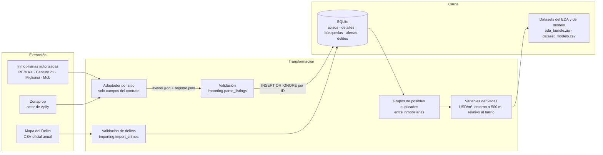

# Diseño del ETL

Cómo pasan los datos de las dos fuentes del análisis (avisos vigentes autorizados y Mapa del Delito de CABA) a la
base y a los datasets del EDA y del modelo. Cada regla de este documento está en el código y tiene pruebas. Los
números salen de una corrida real que se reproduce con:

```powershell
python -m precio_entorno.etl_reporte
```

El comando carga la captura consolidada de venta y el CSV de delitos de 2025 en una base temporal, sin tocar la
base real. Deja el resultado en `data/processed/etl/reporte.json`.

## 1. Flujo



| Etapa | Módulo | Entrada | Salida |
| --- | --- | --- | --- |
| Extracción | `inmobiliarias.py`, `zonaprop_apify.py` | Sitios con permiso de lectura y el actor de Zonaprop | `avisos.json` (contrato) y `registro.json` (estado por sitio, omitidos y posibles duplicados) |
| Validación de avisos | `importing.parse_listings` | `avisos.json` o un CSV del catálogo | Avisos válidos y un reporte con leídos, descartados, faltantes e inválidos por campo |
| Carga de avisos | `store.ingest` | Avisos válidos | Filas nuevas y alertas por cada ID nuevo que encaja con una búsqueda guardada |
| Validación y carga de delitos | `importing.import_crimes` | CSV anual del Mapa del Delito | Hechos con fecha, barrio, tipo, franja y cantidad |
| Derivadas | `modelo.py`, `eda_colab.py` | Base y capas de entorno | USD/m², distancias y conteos a 500 m, grupo de duplicados y paquete del EDA |

## 2. Corrida real

### Avisos de venta (captura consolidada del 7 al 9 de noviembre de 2026)

| Paso | Filas | Detalle |
| --- | ---: | --- |
| Omitidos por los adaptadores | 213 | Barrio ambiguo (109), fuera de alcance (37), fuera de CABA (37) y emprendimientos o avisos no activos (30). Nunca llegan al archivo. |
| Leídos por la validación | 4.007 | RE/MAX 600, Century 21 600, Migliorisi 428, Clarín 20 y Zonaprop 2.409 |
| **Aceptados** | **3.806** | 95 % de lo leído |
| Descartados | 201 | Les falta un campo obligatorio o un valor queda fuera de rango (ver abajo) |
| Duplicados por ID | 0 | Cada ID con prefijo de inmobiliaria aparece una sola vez en la captura |
| Posibles duplicados entre inmobiliarias | 446 avisos en 221 grupos | Se marcan; no se borran (sección 4) |
| **Reimportación del mismo lote** | 0 nuevos · 3.806 repetidos · **0 alertas** | Volver a cargar un lote no agrega filas ni repite alertas |

Faltantes e inválidos de los 4.007 leídos, por campo:

| Campo | Obligatorio | Faltante | Inválido | Tratamiento |
| --- | :---: | ---: | ---: | --- |
| `price` | sí | 19 | — | Se descarta el aviso. Los precios de relleno (888.888, 999.999) se convierten en faltantes en el adaptador. |
| `currency` | sí | 9 | 8 | Se descarta. En venta solo se acepta USD (`U$S` y `US$` se normalizan a USD). |
| `covered_area_m2` | sí | 100 | 7 | Se descarta. Rango de 10 a 2.000 m². |
| `rooms` | sí | 13 | — | Se descarta. Entero entre 1 y 20. |
| `neighborhood` | sí | 59 | — | Se descarta. Tiene que ser uno de los 48 barrios oficiales (sección 3). |
| `total_area_m2` | no | 178 | 4 | Queda sin dato. Si es menor que la cubierta, se anula. |
| `expenses` | no | 2.304 (58 %) | 42 | Queda sin dato. Mínimo ARS 1.000, para no leer «95.000» como 95. |
| `latitude` / `longitude` | no | 464 (12 %) | 5 / 4 | Queda sin dato. Rango: el rectángulo de CABA. Sin pin no se calculan las variables a 500 m. |
| `age_years`, `condition`, `garages`, `floor` | no | 4.007 | — | Esta captura es anterior a esos campos. Se agregan por ID desde las capturas `*-edificio`, sin capturar de nuevo. |
| Precio por m² | regla | — | — | En venta tiene que estar entre 200 y 20.000 USD/m²; si no, se descarta. |

### Delitos registrados de 2025

| Paso | Filas | Detalle |
| --- | ---: | --- |
| Leídos | 133.203 | CSV oficial del Mapa del Delito de 2025 |
| **Aceptados** | **130.418** | 97,9 % |
| Descartados | 2.785 | Sin barrio: no se pueden asignar a una unidad geográfica |
| Franja horaria faltante | 155 | Se conservan como franja desconocida |
| Duplicados | 0 | La clave es año + `id_mapa`: el mismo hecho no se cuenta dos veces |

### Entrada inválida (lote ficticio)

`etl_reporte` también valida un lote de 7 filas con errores de carga típicos. Solo pasa la fila correcta:

| Fila | Error | Resultado |
| --- | --- | --- |
| `ficticio:ok` | — | Aceptada |
| `ficticio:miles` | Precio «120.000» escrito como texto | Se lee 120, queda fuera de rango y se descarta |
| `ficticio:pesos` | Precio en ARS en el catálogo de venta | Se descarta por moneda |
| `ficticio:barrio` | Barrio «Gotham» | Se descarta por barrio |
| `ficticio:m2` | 5 m² cubiertos | Se descarta por superficie |
| `ficticio:usd_m2` | 75 USD/m² | Se descarta por precio por m² |
| `ficticio:url` | Enlace `javascript:` | Se descarta por URL: solo se aceptan http y https |

## 3. Normalización

- **Nombres de columna y de barrio:** se pasan a minúsculas, sin tildes y con `_` en lugar de espacios y guiones
  (`importing.key`). Así, «Núñez», «Nuñez» y «NUÑEZ» son el mismo barrio.
- **Alias de barrio:** «Boca» pasa a La Boca, «Paternal» a La Paternal, «Monserrat» a Montserrat y «Villa Gral.
  Mitre» a Villa General Mitre. Zonaprop busca con algunos de esos nombres.
- **Subzonas comerciales:** las que tienen un único barrio oficial se reasignan, por ejemplo Palermo Hollywood a
  Palermo, Barrio Norte a Recoleta y Abasto a Balvanera. Las ambiguas, como Congreso, Centro o Parque Centenario,
  no se adivinan: el aviso se omite y se cuenta como `barrio_ambiguo`.
- **Números a la argentina:** «1.100.540» se lee como miles y «52,5» como decimal (`local_number`).
- **Moneda:** venta solo en USD; alquiler en ARS o USD, sin conversión.
- **Estado de la propiedad:** las etiquetas de cada fuente se llevan a una sola escala (a estrenar, en construcción,
  excelente, muy bueno, bueno, regular, reciclado y a reciclar).
- **Antigüedad:** si la fuente publica el año de construcción, se calcula la antigüedad a la fecha de captura. Un
  año futuro, de un edificio en construcción, cuenta como 0.
- **Piso:** «PB» y «Planta baja» valen 0, y «9°F» vale 9.

## 4. Duplicados

- **Dentro de una fuente:** el ID lleva el prefijo de la inmobiliaria (`remax:…`, `zonaprop:…`) y la carga usa
  `INSERT OR IGNORE`. Un aviso ya cargado no se vuelve a insertar ni genera otra alerta, como mostró la
  reimportación. Si vuelve a aparecer con otro precio publicado, se actualiza el precio y se agrega una fila a
  `listing_prices` (sección 4 bis).

## 4 bis. Vigencia: avisos vendidos, reservados o retirados

Un aviso que deja de publicarse **no se borra**: cambia su `status` en `listings`. La base guarda además
`last_seen` (última captura en la que apareció) y `status_at` (cuándo cambió el estado).

| Estado | Cuándo | ¿Cuenta en medianas, búsqueda y mapa? |
| --- | --- | --- |
| `activo` | Apareció en la última captura o nunca se verificó su ausencia | Sí |
| `no_visto` | Faltó en **un** barrido completo de su fuente | Sí, puede ser una falla pasajera del sitio |
| `baja` | Faltó en **dos** barridos completos seguidos | No. En Mis alertas figura como «Ya no está publicado» |
| `reservado` | Definido para fuentes que lo publiquen; hoy ninguna lo informa | No |

- **Ausencia no es baja.** La actualización de cada dos días lee los avisos **más recientes** con un tope, así
  que un aviso que falta pudo quedar fuera de la ventana. Solo un **barrido completo** (se leyeron todas las
  páginas de la fuente sin cortar por el tope) puede cambiar vigencias. Cada captura escribe `vistos.json` con
  `barrido_completo` y los IDs vistos por sitio.
- **Fuentes con barrido completo:** Remax, Century 21 y Migliorisi. En Migliorisi, los avisos ya conocidos cuentan
  como vistos sin pedir su ficha. Mob y Clarín no permiten recorrer todo el listado, y Zonaprop se lee con Apify por
  barrio con un tope: sus avisos no cambian de vigencia con esta regla (fase 2: verificación selectiva).
- **Freno de seguridad:** si en un barrido falta más del 30 % de los avisos vigentes de la fuente, se supone una
  falla del sitio o del lector y no se cambia nada (`aplicado: false` en el historial).
- **Reaparición:** un aviso dado de baja que vuelve a aparecer pasa a `activo` y se vuelve a comparar con las
  búsquedas.
- **Precio:** si cambia, se guarda en `listing_prices` (precio, moneda y fecha) y se vuelve a comparar con las
  búsquedas: una baja de precio puede hacerlo entrar en un presupuesto y genera una alerta (una sola vez por
  búsqueda). Una captura más vieja que `last_seen` no cambia nada. Son **precios publicados**, no de cierre: una
  baja indica que el aviso dejó de publicarse, no que se vendió a ese precio.
- **Cómo correrlo:** `python -m precio_entorno.actualizar --autorizacion-confirmada --barrido-completo` recorre
  hasta 20.000 avisos por inmobiliaria. No usa Apify, pero tarda más por la pausa entre pedidos. Conviene una vez por
  semana; el resto de las corridas siguen siendo de recientes. La primera vez en Migliorisi pide la ficha de cada
  aviso que no está en la base.
- **Bases existentes:** al abrirlas se agregan las columnas nuevas, `last_seen` toma la fecha de captura y cada
  aviso recibe su primer precio en `listing_prices`.
- **Entre fuentes:** la misma propiedad puede estar publicada por dos inmobiliarias. Se marcan como posibles
  duplicados los avisos de **distintas inmobiliarias** con el mismo barrio y la misma cantidad de ambientes, los
  mismos m² cubiertos redondeados y el mismo precio redondeado a miles. En esta captura son **221 grupos con 446
  avisos**.
  - **No se borran**, porque la coincidencia es aproximada.
  - El modelo los usa como `grupo` en `GroupKFold`: las copias nunca quedan una en entrenamiento y otra en prueba.
  - El EDA cuenta cada grupo una sola vez cuando busca oportunidades.

## 5. Faltantes

- **Campos obligatorios** (ID, enlace, fecha de captura, precio, moneda, superficie cubierta, ambientes y
  barrio): sin cualquiera de ellos, el aviso se descarta y se cuenta por campo.
- **Campos opcionales:** quedan como `NULL`. **No se imputan en la base.**
  - El EDA los muestra como «sin dato» e informa la cobertura por fuente.
  - El modelo usa `HistGradientBoostingRegressor`, que trata los faltantes de forma nativa.
  - Las variables a 500 m solo se calculan para avisos con pin.
- **Delitos:** sin barrio, el hecho se descarta. Sin franja, queda como desconocida. Los totales se muestran
  siempre con su período y su unidad geográfica.

## 6. Pruebas

| Regla | Prueba |
| --- | --- |
| Validación de campos, rangos y monedas | `tests/test_importing.py` (`test_implausible_prices_and_areas_are_discarded`, `test_building_fields_are_optional_and_validated`) |
| Reimportación sin filas nuevas ni alertas | `tests/test_importing.py` (`test_csv_validates_and_alerts_only_once`), `tests/test_actualizar.py`, `tests/test_etl_reporte.py` |
| Vigencia: dos barridos para la baja, freno de seguridad, reaparición, historial de precios y migración | `tests/test_vigencia.py` |
| Delitos: cobertura, faltantes y reimportación | `tests/test_importing.py` (`test_crime_counts_coverage_and_reimport`) |
| Grupos de posibles duplicados entre fuentes | `tests/test_consolidar.py` (`test_duplicate_groups_only_join_different_sources`) |
| Reporte de la corrida y lote inválido | `tests/test_etl_reporte.py` |
