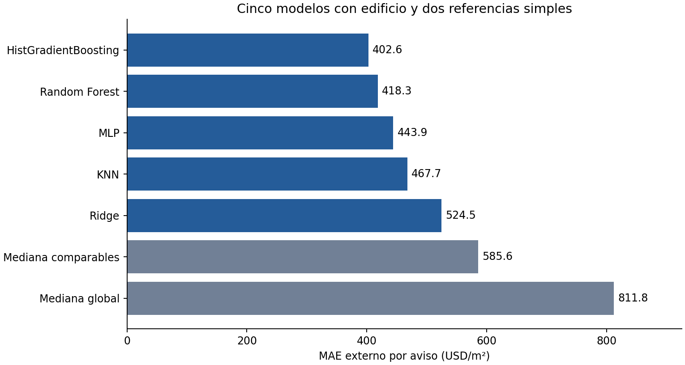
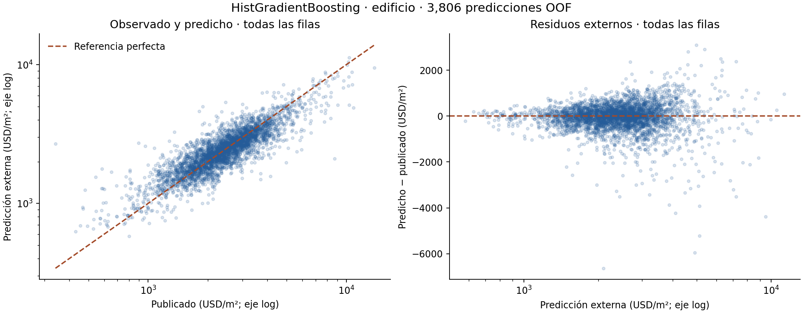

# Lüga: memoria matemática y metodológica

Versión del 18 de noviembre de 2026. La memoria conecta las preguntas del capstone con las ecuaciones y el código que las responde. La comparación principal es el benchmark anidado de **Ridge, KNN, Random Forest, HistGradientBoosting y MLP**. Sus resultados auditados se generan en [`reports/benchmark-auditado/resultados.md`](../reports/benchmark-auditado/resultados.md). El ANOVA responde una pregunta descriptiva diferente.

## 1. Qué estimamos y sobre qué población

Una inmobiliaria necesita comparar avisos compatibles con una búsqueda y decidir cuáles revisar. La respuesta del modelo para el aviso $i$ es

$$
y_i=\frac{P_i}{A_i},\qquad y_i>0,
$$

donde $P_i$ es el precio **publicado** en USD y $A_i$ la superficie cubierta en m². Por tanto, $y_i$ se mide en USD/m². La predicción $\widehat y_i=f(\mathbf x_i)$ representa una referencia de publicación para atributos $\mathbf x_i$, sin constituir tasación ni precio esperado de cierre.

El catálogo contiene 3.806 avisos de 48 barrios, correspondientes a 3.582 grupos aproximados de propiedades. Un aviso es la unidad observada; el grupo es la unidad de partición y remuestreo. El muestreo por fuentes y topes no es probabilístico: la población accesible es el catálogo autorizado capturado en noviembre de 2026. Generalizar a todos los inmuebles, otro período o una fuente nueva exige evidencia adicional.

La partición conserva juntas las copias detectadas por la heurística del proyecto. Como esa heurística utiliza precio redondeado además de atributos físicos, el grupo no equivale a un identificador inmobiliario independiente: quedan errores posibles de agrupación. Edificios o microzonas compartidos pueden producir dependencia aun entre grupos diferentes.

La superficie aparece en el denominador del objetivo y también como predictor. Una asociación superficie–USD/m² puede contener acoplamiento matemático; no mide por sí sola una causalidad económica. Los delitos registrados se presentan con período y unidad geográfica y no forman parte de estos cinco predictores. El radar editorial tampoco interviene.

## 2. Variables, preprocesamiento y escala del objetivo

El escenario **base** utiliza diez variables numéricas: superficie cubierta y total, ambientes, latitud, longitud, distancias a transporte, parques y hospitales, y conteos de gastronomía y escuelas a 500 m. Agrega barrio e inmobiliaria como categorías. El escenario **edificio** suma antigüedad y estado de conservación nominal.

En Ridge, KNN, Random Forest y MLP los faltantes numéricos se imputan con la mediana del entrenamiento y se añaden indicadores de ausencia. Las categorías se representan mediante one-hot, admitiendo categorías nuevas con un vector de ceros. Ridge, KNN y MLP estandarizan las variables numéricas imputadas:

$$
\widetilde x_{ij}=\frac{x_{ij}^{\mathrm{imp}}-\widehat\mu_j}{\widehat\sigma_j}.
$$

Aquí $\widehat\mu_j$ y $\widehat\sigma_j$ se estiman en la partición de entrenamiento correspondiente. El HGB utiliza categorías codificadas ordinalmente, marcadas explícitamente como categóricas, y faltantes numéricos nativos. El código de estado no impone una distancia ordinal al predictor.

Todo el preprocesamiento está dentro de un `Pipeline`. Se aprende nuevamente en cada pliegue interno y externo. Guardar las transformaciones evita cambiar el significado de los códigos al predecir un lote nuevo. [Pipelines de scikit-learn 1.7](https://scikit-learn.org/1.7/modules/compose.html).

Los cinco modelos del benchmark se ajustan sobre

$$
z_i=\log y_i,\qquad \widehat y_i=\exp\{\widehat f(\mathbf x_i)\}.
$$

Para expresarlo dimensionalmente puede entenderse $z_i=\log[y_i/(1\;\mathrm{USD/m²})]$: el argumento del logaritmo es adimensional y la transformación inversa recupera USD/m².

Una predicción de la media de $Z$ transformada por exponencial da una media geométrica condicional, no en general la media aritmética de $Y$:

$$
\exp\{E[Z\mid X]\}\leq E[\exp Z\mid X]=E[Y\mid X].
$$

La desigualdad expresa la convexidad de la exponencial. Si $Z\mid X=x$ fuera normal con media $m(x)$ y varianza $\sigma^2(x)$, entonces $E[Y\mid x]=\exp\{m(x)+\sigma^2(x)/2\}$ y su mediana sería $\exp m(x)$. No se ha demostrado ese supuesto. El benchmark no aplica corrección de retransmisión: selecciona por MAE observado en USD/m². El escalado adicional del objetivo de MLP es afín y se invierte antes de exponenciar. No debe presentarse la salida de ninguno de ellos como una media aritmética garantizada.

## 3. Los cinco modelos y sus decisiones de ajuste

### 3.1 Ridge: una referencia lineal regularizada

Con la matriz de atributos transformados $\widetilde X$, Ridge obtiene

$$
(\widehat b,\widehat{\boldsymbol\beta})=
\arg\min_{b,\boldsymbol\beta}
\left[\sum_{i\in T}(z_i-b-\widetilde{\mathbf x}_i^\top\boldsymbol\beta)^2
+\alpha\|\boldsymbol\beta\|_2^2\right].
$$

$T$ es entrenamiento y $\alpha$ controla la contracción de coeficientes; el intercepto no se penaliza. Se busca $\alpha\in\{1,10,100\}$. La penalización limita inestabilidad ante atributos correlacionados, pero mantiene una relación aditiva en escala logarítmica. Un coeficiente numérico devuelto a su escala original describe un cambio multiplicativo $\exp(\beta_j\Delta x_j)$, condicionado al resto de entradas, sin interpretación causal automática. El escalado hace comparables las penalizaciones de variables numéricas; no garantiza igual penalización efectiva entre todas las categorías. [Formulación de Ridge](https://scikit-learn.org/1.7/modules/linear_model.html#ridge-regression-and-classification).

### 3.2 KNN: una referencia local dependiente de la distancia

Para los $k$ vecinos más próximos a $\mathbf x$ en el espacio transformado,

$$
\widehat z(\mathbf x)=
\frac{\sum_{i\in N_k(\mathbf x)}w_i z_i}{\sum_{i\in N_k(\mathbf x)}w_i},
\qquad w_i=\frac{1}{d(\widetilde{\mathbf x},\widetilde{\mathbf x}_i)}.
$$

La implementación usa distancia euclídea y $k\in\{8,20,40\}$, con ponderación inversa por distancia. Ante distancias cero, scikit-learn asigna el peso a las coincidencias exactas. La salida en USD/m² es una media geométrica ponderada de los precios vecinos. La estandarización evita que una columna medida en metros domine por su magnitud; aun así, coordenadas, indicadores y categorías contribuyen a una métrica convencional que requiere sensibilidad, no validación causal. KNN tiene poca capacidad para extrapolar fuera del soporte observado. [Regresión por vecinos](https://scikit-learn.org/1.7/modules/neighbors.html#nearest-neighbors-regression).

### 3.3 Random Forest: promedio de árboles aleatorizados

El bosque combina $B$ árboles,

$$
\widehat z(\mathbf x)=\frac1B\sum_{b=1}^{B}T_b(\mathbf x).
$$

Cada árbol se ajusta a una muestra bootstrap del entrenamiento y considera subconjuntos aleatorios de atributos al dividir nodos. Con criterio cuadrático, cada hoja predice la media de $z$ de sus observaciones. Se usan $B=100$, `max_features=0.7` y `min_samples_leaf` en $\{2,5,10\}$. Promediar reduce parte de la varianza; su eficacia depende de la correlación entre árboles. Permite interacciones y formas no lineales sin escalado numérico. Los umbrales sobre columnas one-hot son divisiones binarias de esas columnas. La predicción final es la exponencial del promedio logarítmico del bosque. [RandomForestRegressor 1.7](https://scikit-learn.org/1.7/modules/generated/sklearn.ensemble.RandomForestRegressor.html).

### 3.4 HistGradientBoosting: correcciones sucesivas

El modelo se construye de forma aditiva,

$$
F_M(\mathbf x)=F_0+\nu\sum_{m=1}^{M}h_m(\mathbf x),
$$

donde $\nu$ es la tasa de aprendizaje. Cada árbol aproxima una corrección derivada de la pérdida actual. Para el cuadrado, los gradientes son proporcionales a $F_{m-1}(\mathbf x_i)-z_i$. La implementación utiliza histogramas y gradientes/Hessianos para construir divisiones y valores de hoja; no es una regresión independiente de cada árbol contra el objetivo original.

En este benchmark: pérdida cuadrática sobre $z$, $M=220$, $\nu=0.1$, hasta 31 hojas, regularización L2 de hojas igual a cero y mínimo por hoja en $\{10,20,40\}$. La parada temprana está desactivada para evitar una separación interna ajena a los grupos. El manejo nativo de categorías y faltantes limita preprocesamiento artificial, sin resolver diferencias entre la distribución de entrenamiento y la de operación. [Fundamento de boosting por histogramas](https://scikit-learn.org/1.7/modules/ensemble.html#histogram-based-gradient-boosting) y [parámetros efectivos](https://scikit-learn.org/1.7/modules/generated/sklearn.ensemble.HistGradientBoostingRegressor.html).

### 3.5 MLP: una composición no lineal regularizada

Para dos capas ocultas,

$$
\mathbf h_1=\operatorname{ReLU}(W_1\widetilde{\mathbf x}+\mathbf b_1),\quad
\mathbf h_2=\operatorname{ReLU}(W_2\mathbf h_1+\mathbf b_2),\quad
\widehat u=\mathbf w_3^\top\mathbf h_2+b_3.
$$

Aquí $u=(z-\mu_z)/\sigma_z$, con parámetros estimados solo en entrenamiento. La red usa capas de 48 y 24 unidades y salida lineal. Para un lote $B$, sin pesos muestrales, la implementación calcula

$$
\mathcal L_B=\frac1{2|B|}\sum_{i\in B}(u_i-\widehat u_i)^2
+\frac{\alpha}{2|B|}\sum_{\ell}\|W_\ell\|_F^2.
$$

La penalización se aplica a pesos, no a interceptos. Se verificó la normalización por tamaño de lote en `_backprop` de la versión instalada; `batch_size='auto'` usa hasta 200 observaciones por lote. Se busca $\alpha\in\{0.001,0.01,0.1\}$; optimizador Adam, tasa inicial 0,001, hasta 250 épocas, tolerancia 0,001 y parada temprana desactivada. La solución no garantiza mínimo global. Se conservan advertencias y épocas de cada refit. Alcanzar el límite describe un presupuesto agotado, no la capacidad óptima de la familia. [MLPRegressor 1.7](https://scikit-learn.org/1.7/modules/generated/sklearn.neural_network.MLPRegressor.html).

## 4. Selección, evaluación y baselines

Los hiperparámetros de cada familia se seleccionan con validación anidada: cinco folds externos y tres internos, siempre por grupo. Para una partición externa $V_k$, se busca la configuración $\lambda$ utilizando únicamente $T_k=D\setminus V_k$:

$$
\widehat\lambda_k=\arg\min_{\lambda\in\Lambda}
\frac13\sum_{j=1}^{3}\frac1{|V_{kj}|}
\sum_{i\in V_{kj}}|y_i-\exp\{\widehat f_{kj,\lambda}(\mathbf x_i)\}|.
$$

Después se reajusta sobre todo $T_k$ y se predice $V_k$. Cada aviso recibe una predicción externa por modelo y escenario. La selección interna promedia los tres errores medios de fold con igual peso; la tabla externa reúne todas las predicciones y pondera por aviso. La búsqueda es acotada, con tres configuraciones por familia. [Por qué separar búsqueda y evaluación](https://scikit-learn.org/1.7/auto_examples/model_selection/plot_nested_cross_validation_iris.html).

La auditoría agrega dos baselines de complejidad baja: mediana global y mediana por barrio y ambientes, con al menos cinco grupos; respaldo barrial y luego global. Sus medianas se estiman solo con entrenamiento, con igual peso por grupo dentro del segmento. Se conserva además el HGB fijo del EDA como referencia histórica, no como baseline simple. Los baselines no cuentan dentro de las cinco familias exigidas.

La validación anidada protege frente a la búsqueda de hiperparámetros dentro de cada familia. Escoger luego la mejor familia y escenario a partir de sus resultados externos todavía introduce selección. Por eso se informa el mejor observado, sin presentar su error como confirmación independiente del ganador. Los folds comparten gran parte del entrenamiento: no se aplica ANOVA ordinario a sus MAE como si fueran réplicas independientes. [Dependencia en comparación de modelos](https://scikit-learn.org/1.7/auto_examples/model_selection/plot_grid_search_stats.html).

## 5. Métricas e incertidumbre

Con error firmado $e_i=\widehat y_i-y_i$ y $n$ predicciones externas,

$$
\mathrm{MAE}=\frac1n\sum_i|e_i|,\qquad
\mathrm{RMSE}=\sqrt{\frac1n\sum_i e_i^2},\qquad
\mathrm{sesgo}=\frac1n\sum_i e_i,
$$

$$
R^2=1-\frac{\sum_i e_i^2}{\sum_i(y_i-\bar y)^2},\qquad
\mathrm{MdAPE}=100\operatorname{mediana}_i\left(\frac{|e_i|}{y_i}\right).
$$

MAE, RMSE y sesgo están en USD/m²; MdAPE es porcentual. RMSE penaliza más errores grandes. Un sesgo negativo indica subestimación media. $R^2$ es relativo a la media del conjunto evaluado, puede ser negativo y no representa probabilidad de acierto. El denominador porcentual es el valor observado, no la predicción.

El MAE principal pondera por aviso, de modo que una propiedad republicada puede pesar varias veces dentro del conjunto externo. Se reporta también

$$
\mathrm{MAE}_{\mathrm{grupo}}=\frac1G\sum_{g=1}^{G}
\left(\frac1{n_g}\sum_{i\in g}|e_i|\right),
$$

con igual peso por propiedad aproximada. La brecha entre MAE externo y MAE de entrenamiento es un diagnóstico descriptivo de optimismo, no un test de sobreajuste. El MAE de entrenamiento del reporte promedia los cinco reajustes de fold; las muestras externas están reunidas por aviso.

Para comparar con el baseline de comparables se forma $d_i=|e_i^{\mathrm{modelo}}|-|e_i^{\mathrm{ref}}|$. Se remuestrean $G$ grupos con reemplazo, conservando juntas sus filas y la correspondencia entre modelos. En 600 remuestreos se calcula $\Delta^{*(b)}=\sum_g d_g^{*(b)}/\sum_g n_g^{*(b)}$; sus percentiles 2,5 y 97,5 dan un intervalo condicional para la diferencia de MAE por aviso. Un valor negativo favorece al modelo.

El intervalo mantiene fijos modelos y predicciones OOF. No incluye toda la incertidumbre de reentrenamiento, búsqueda, selección de familia o cambio de mercado, ni corrige simultáneamente todos los modelos comparados. El desvío de cinco MAE por fold tampoco es un intervalo de confianza. No deben usarse estos intervalos de MAE como intervalos para el precio de un inmueble individual.

### Resultados reproducidos y lectura de los errores

Los cinco modelos en el escenario edificio se evaluaron sobre las mismas 3.806 filas externas. Las referencias simples usan esos mismos folds, sin variables de edificio:

| Modelo / referencia | MAE (USD/m²) | RMSE (USD/m²) | R² | MdAPE |
| --- | ---: | ---: | ---: | ---: |
| HistGradientBoosting | **402,6** | **614,0** | **0,736** | **11,81 %** |
| Random Forest | 418,3 | 648,4 | 0,706 | 12,05 % |
| MLP | 443,9 | 659,1 | 0,696 | 13,12 % |
| KNN | 467,7 | 743,4 | 0,614 | 13,14 % |
| Ridge | 524,5 | 827,9 | 0,521 | 15,52 % |
| Mediana de comparables | 585,6 | 921,1 | 0,407 | 17,13 % |
| Mediana global | 811,8 | 1.208,8 | −0,022 | 24,16 % |



HGB con edificio reduce el MAE un 31,2 % respecto de comparables. Su diferencia emparejada es −183,0 USD/m², con intervalo bootstrap condicional de aproximadamente [−200,0; −165,1]. Ese intervalo describe la comparación con el baseline, no establece por sí solo superioridad estadística frente a Random Forest. Con igual peso por grupo, el MAE del HGB es 403,9, muy cercano al ponderado por aviso. Su MAE de entrenamiento medio es 154,1: la brecha de 248,5 frente al externo indica optimismo de entrenamiento importante, aun cuando supera a las referencias en evaluación externa.

Los diez reajustes externos de MLP terminaron entre 100 y 137 épocas, antes del máximo de 250, y la búsqueda/refit no emitió advertencias de convergencia. Esto verifica el criterio numérico configurado, sin demostrar un óptimo global ni agotar el potencial de otras arquitecturas.



La figura usa todas las filas, sin recortar errores extremos. La dispersión residual crece en parte del rango de predicción y hay subestimaciones grandes; el sesgo agregado del HGB es −45,9 USD/m². Un solo MAE no caracteriza bien ese riesgo. La mejora tampoco es uniforme por fuente: en RE/MAX, el MAE del HGB pasa de 453,7 con base a 480,4 con edificio, mientras que el resultado agregado mejora. La dependencia entre fuente, segmento y faltantes impide atribuir toda la mejora a antigüedad o estado por separado. Las tablas por fuente y barrio se conservan en la evidencia.

## 6. ANOVA: una pregunta descriptiva sobre barrios

Para el grupo inmobiliario aproximado $i$ del barrio $g$, se analiza su mediana de USD/m² mediante

$$
Y_{ig}=\mu_g+\varepsilon_{ig},\qquad
H_0:\mu_1=\cdots=\mu_K,\quad K=48.
$$

El ANOVA clásico supone errores independientes, aproximadamente normales y de varianza común. Define

$$
SC_B=\sum_gn_g(\bar Y_g-\bar Y)^2,\quad
SC_W=\sum_g\sum_i(Y_{ig}-\bar Y_g)^2,\quad
F=\frac{SC_B/(K-1)}{SC_W/(N-K)}.
$$

Su tamaño de efecto descriptivo es $\eta^2=SC_B/(SC_B+SC_W)$. Para Welch se permite varianza distinta por barrio: $w_g=n_g/s_g^2$, $W=\sum_gw_g$, $\bar Y_w=\sum_gw_g\bar Y_g/W$ y $A=\sum_g(1-w_g/W)^2/(n_g-1)$. Entonces

$$
F_W=\frac{\sum_gw_g(\bar Y_g-\bar Y_w)^2/(K-1)}
{1+2(K-2)A/(K^2-1)},\qquad
\nu_1=K-1,\quad\nu_2=\frac{K^2-1}{3A}.
$$

Se evalúa aproximadamente contra $F_{\nu_1,\nu_2}$. [Supuestos e implementación de ANOVA y Welch](https://docs.scipy.org/doc/scipy-1.16.0/reference/generated/scipy.stats.f_oneway.html).

El cálculo sobre 3.582 unidades dio $F_W=59.14$, grados de libertad $(47,970.25)$ y $p\approx1.57\times10^{-249}$. Se rechaza igualdad global bajo los supuestos; no se infiere que cada par difiera. El $\eta^2$ clásico es 0,454 y describe variación entre barrios en esta muestra, sin interpretación causal o predictiva externa.

Brown–Forsythe encontró heterogeneidad de varianzas; la normalidad global de residuos también se rechazó. Este último diagnóstico agrupa barrios con varianzas distintas y no prueba por separado su normalidad. Welch no corrige dependencia espacial. Kruskal–Wallis se utiliza como sensibilidad de rangos/distribuciones, no como otra prueba de igualdad de medias.

En los $m=1.128$ pares se aplican pruebas t de Welch y corrección Holm. Si $p_{(1)}\le\cdots\le p_{(m)}$, el p ajustado es

$$
\widetilde p_{(i)}=\min\left\{1,\max_{j\le i}(m-j+1)p_{(j)}\right\}.
$$

Resultaron significativos 696 pares al 5 %. Almagro–Caballito tiene diferencia observada de −257,64 USD/m², pero $p_{\mathrm{Holm}}=0.4844$: no se rechaza su igualdad tras controlar la familia completa. Esto no demuestra equivalencia. Los intervalos por par guardados son puntuales, no simultáneos. Véanse [datos, resultados y límites del ANOVA](anova-barrios.md).

## 7. Conexión con operación y negocio

El benchmark anidado y el artefacto actualmente integrado en Streamlit son experimentos diferentes. El artefacto operativo usa HGB con pérdida absoluta sobre USD/m², 300 iteraciones, tasa 0,05 y rasgos adicionales de descripción; su evaluación usa desarrollo/prueba 80/20. El benchmark compara cinco familias sobre log(USD/m²) con otros atributos y particiones. El MAE de 442,7 del artefacto no es el error externo del ganador del benchmark. Esta separación debe conservarse en la defensa.

En la prueba del artefacto operativo, retirar el enriquecimiento elevó el MAE de 442,7 a 616,0 USD/m². Esto muestra que disponibilidad de atributos es parte del contrato estadístico de operación. Las próximas predicciones deben registrar versión, fecha, faltantes, categorías nuevas y fuente. La pérdida absoluta busca aproximar una mediana condicional en escala original; es un funcional diferente del ajuste cuadrático sobre logaritmos.

La métrica de negocio propuesta es $\Delta t=t_{\mathrm{habitual}}-t_{\mathrm{app}}$ por revisión, incluyendo comprobación y descarte de candidatos. Con $R$ revisiones mensuales y costo del tiempo $c_h$ en USD/h, el beneficio imputado es $B=R\overline{\Delta t}\,c_h/60$. Beneficio neto del cliente $=B-\text{cuota}$ y retorno sobre cuota $=(B-\text{cuota})/\text{cuota}$. Son fórmulas de planificación; no hay medición de ahorro del cliente todavía. Concordancia con un ranking de comparables no equivale a utilidad, venta o rentabilidad.

Antes de una afirmación comercial se debe congelar el modelo y evaluar una captura posterior, con atributos disponibles a la fecha de publicación y control de grupos conocidos. La prueba debe medir errores, cobertura, vigencia y tiempo de revisión, y contrastar la disponibilidad completa de atributos con los campos básicos. Un criterio de aceptación se acuerda antes de observar esa nueva muestra; no se elige retrospectivamente para aprobar el modelo.

## 8. Reproducción y lectura de la evidencia

```powershell
python -m precio_entorno.auditoria_estadistica
python scripts/graficar_auditoria.py
python -m precio_entorno.anova_barrios
python -m unittest discover -s tests -v
```

El primer comando conserva predicciones externas individuales en `data/processed/auditoria-estadistica/` (fuera de Git). Exporta métricas, ajustes y subgrupos agregados a `reports/benchmark-auditado/`, junto con hashes de bundle, código y predicciones, versiones y verificación de las particiones. No ejecuta extracciones ni consume APIs. Los resultados son reproducibles dentro de la tolerancia numérica del entorno registrado; tiempos y hardware no son invariantes.

La corrida omite el cálculo opcional de importancias y dependencias parciales porque esta auditoría verifica desempeño, baselines y convergencia; las interpretaciones históricas permanecen identificadas en el notebook existente. La [matriz de auditoría](auditoria-estadistica.md) registra hallazgos, correcciones y alcance de las conclusiones.

La skill pasó su validador estructural y se aplicó a esta auditoría. La suite requerida del proyecto terminó con **258 pruebas aprobadas**. Las dos figuras se generaron a partir de las predicciones cuyo hash figura en el manifiesto y se inspeccionaron visualmente.

## 9. Referencias y alcance de su consulta

Las secciones de modelos enlazan documentación oficial de la versión 1.7, correspondiente a scikit-learn 1.7.2 en la corrida. Los supuestos de ANOVA se contrastaron con la documentación de SciPy 1.16 y la normalización de MLP se verificó además en el código instalado. Estas son las fuentes de la correspondencia con la implementación.

Como referencia académica primaria para el promedio de árboles y el papel de su dependencia se consultó Breiman, L. (2001), *Random Forests*, Machine Learning, 45, 5–32, especialmente su sección de regresión: [texto del artículo alojado en Johns Hopkins](https://www.ams.jhu.edu/~priebe/COURSES/FALL2003/550.730/RF/breiman-rf.pdf). Sus resultados asintóticos no certifican el comportamiento de nuestro bosque finito ni la representatividad de esta muestra.

Para estudio teórico complementario: James, G., Witten, D., Hastie, T., Tibshirani, R. y Taylor, J. (2023), *An Introduction to Statistical Learning: with Applications in Python*, Springer, DOI 10.1007/978-3-031-38747-0. Se verificaron ficha e índice editorial: capítulos 2 (aprendizaje), 5 (remuestreo), 6 (regularización), 8 (árboles), 10 (redes) y 13 (pruebas múltiples). [Ficha editorial](https://link.springer.com/book/10.1007/978-3-031-38747-0) y [sitio de los autores](https://www.statlearning.com/home). Esta memoria no declara una revisión exhaustiva de todos esos capítulos ni reproduce sus demostraciones.
